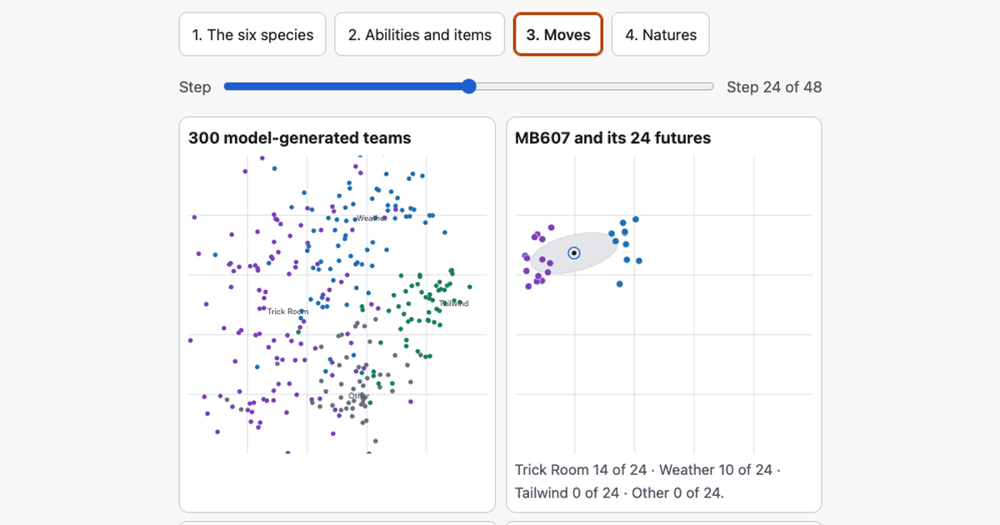

# Battle Factory of Porygon-Pi

[](LICENSE)
[](code/README.md)
[](https://rami-ismael.github.io/Battle-Factory-of-Porygon-Pi/blog/beating-the-meta-pokemon-vgc/)
[](https://github.com/Rami-Ismael/Battle-Factory-of-Porygon-Pi/actions/workflows/pages/pages-build-deployment)

Searching the space of competitive Pokémon VGC teams (Champions Reg Set M-B) for teams that beat a meta, using a diffusion proposer, a battle simulator and a surrogate.

**Result (2026-10-08).** The best team the search found wins 0.667 of simulated battles against the 50 top-placing meta teams, within noise of the best real team (0.691, standard error about 0.03). Across the 16 best finalists the average is 0.581, so the search reaches the level of real teams but has not beaten them.

*Win rate = wins ÷ battles against those 50 teams, one battle per pairing, with the same behaviour-cloned battle policy piloting both sides. A top-50 team scores 0.531 against the other 49. Source: [`code/docs/cem-v3-loop.md`](code/docs/cem-v3-loop.md).*

### Table of contents

1. [What's in the repo](#whats-in-the-repo)
2. [Installation](#installation)
3. [Where the truth lives](#where-the-truth-lives)
4. [Licence](#licence)
5. [Acknowledgements](#acknowledgements)

**[Find a strong team without Kingambit](https://rami-ismael.github.io/Battle-Factory-of-Porygon-Pi/blog/kingambit-finder/)** — search 549 Regulation M-B teams by typing a Pokémon or clicking a sprite, then open a matchup matrix of the top results against the 49 top-placing teams. Source and rebuild notes: [`blog/kingambit-finder/`](blog/kingambit-finder).

**[Random noise to Pokémon team archetypes](https://rami-ismael.github.io/Battle-Factory-of-Porygon-Pi/notes/Blog/visuals/noise-to-archetypes/noise-to-archetypes.html)** — one Regulation M-B team sampled from the masked diffusion model, going from pure noise to a finished team. Grainy boxes are masked fields. At each of the 48 steps the field being decided spins like a slot reel through the model's top candidates while bars show each one's probability, and the reel stops on the token the model drew. Pick a Trick Room, Tailwind, rain, snow, sand, sun or no-archetype example to watch a different archetype form.

[](https://rami-ismael.github.io/Battle-Factory-of-Porygon-Pi/notes/Blog/visuals/noise-to-archetypes/noise-to-archetypes.html)

Below the team, all 512 sampled teams play out at once as dots that leave a Gaussian cloud and settle into archetype clusters. The page is one offline file with its data and sprites embedded.

The model starts from masked categorical fields, not Gaussian noise: the cloud stands in for the fields still masked, and the anchor ring is a chosen layout, not a learned embedding. The figure shows what the model generates, not how well those teams play. The later play-and-scrub version, with its [method notes and verification](notes/Blog/visuals/archetype-diffusion/README.md), stays at [`archetype-diffusion/`](https://rami-ismael.github.io/Battle-Factory-of-Porygon-Pi/notes/Blog/visuals/archetype-diffusion/archetype-diffusion.html).

## What's in the repo

| Folder | What it is |
| --- | --- |
| [`notes/`](notes) | The research notes: Markdown, Obsidian-flavoured (`[[links]]`), plus the daily posts and the interactive figures. |
| [`code/`](code) | The pipeline: team generator, battle runner, search loops, GUI. Start at [`code/README.md`](code/README.md). |
| [`blog/`](blog) | The main blog article, [Beating the Meta](blog/beating-the-meta-pokemon-vgc/index.html). Written in this repository and edited in place. |
| [`tools/sync.py`](tools/sync.py) | Copies both folders from the author's laptop and pushes. |

## Installation

Tested on macOS with Python 3.11 and Node.js 22. You need `git`, [`uv`](https://docs.astral.sh/uv/) and Node.js with `npm`.

Battles run on a local Pokémon Showdown server, piloted by the VGC-Bench behaviour-cloned policy. The scripts in `code/` expect this layout, with these paths written into them:

| Path | What goes there |
| --- | --- |
| `/tmp/vgc-pilot/` | the contents of `code/`, plus `.venv/` |
| `/tmp/vgc-pilot/vgc-bench/` | VGC-Bench and its pinned Showdown |
| `/tmp/bc_100.zip` | the behaviour-cloning checkpoint |
| port `8123` | the first Showdown server (`pool.py` uses 8123–8129) |

**1. Copy the code into place.**

```bash
git clone https://github.com/Rami-Ismael/Battle-Factory-of-Porygon-Pi.git
mkdir -p /tmp/vgc-pilot
cp -R Battle-Factory-of-Porygon-Pi/code/. /tmp/vgc-pilot/
```

**2. Get VGC-Bench at the pinned commit.** Its submodule pins the Showdown fork that has the Champions rules. Use that one, not upstream Showdown.

```bash
cd /tmp/vgc-pilot
git clone https://github.com/cameronangliss/vgc-bench.git
cd vgc-bench
git checkout d79f9532947ac114dce1dda2456a590afcd375b2
git submodule update --init --recursive
cd pokemon-showdown && npm install
```

**3. Create the Python environment.** Installing `./vgc-bench` also installs its pinned `poke-env`, Stable-Baselines3 and Gymnasium. If `open-spiel` fails to build, delete it from `vgc-bench/pyproject.toml`; only VGC-Bench's own `eval` module needs it.

```bash
cd /tmp/vgc-pilot
uv venv --python 3.11 --seed .venv
.venv/bin/python -m pip install -r requirements.txt ./vgc-bench
```

**4. Download the battle policy** (11.9 MB, checkpoint 100 of VGC-Bench's behaviour-cloning run) and check its hash.

```bash
curl -L -o /tmp/bc_100.zip https://huggingface.co/cameronangliss/vgc-bench-models/resolve/204c76741829ca0681629e41382043c385850d5c/results/saves_bc/seed1/100.zip
shasum -a 256 /tmp/bc_100.zip
# 57f5edcab415cf6ccc1b6231923c8b66d3b1b7249b6b2562b97531471e4ca60b
```

**5. Start Showdown** and leave it running in its own terminal.

```bash
cd /tmp/vgc-pilot/vgc-bench/pokemon-showdown
node pokemon-showdown start 8123 --no-security
```

**6. Play four battles to check the install.** Two Regulation M-B teams from VGC-Bench play each other, with the policy piloting both sides.

```bash
cd /tmp/vgc-pilot/vgc-bench
PYTHONPATH=$PWD:/tmp/vgc-pilot/src ../.venv/bin/python ../src/scale_test.py 8123 4 4
# PORT 8123 battles 4 secs … rate …
```

If that prints `battles 4`, everything is wired up. The experiments themselves are listed in [`code/README.md`](code/README.md), each with its report under [`code/docs/`](code/docs). The large generated datasets (the 100,000- and 147,000-team files) and trained diffusion checkpoints are not in this repository, so experiments that start from them need retraining first.

## Where the truth lives

The source of truth is the Obsidian vault and the code folder **on the author's laptop**. This repository is a published mirror of them, one-way:

```
Obsidian vault  ──sync──▶  notes/
code folder     ──sync──▶  code/
```

An edit in Obsidian shows up here as the same edit in the next sync. Edit notes locally, not on github.com. When a file changed here after the last sync and the laptop's copy differs, the sync stops and lists the file instead of undoing that edit. Copy the change to the laptop, or overwrite it on purpose with `--allow FILE` (one path per line) or `--force`.

`blog/` is the one folder edited in place. The sync stages only `notes/` and `code/`, so it never touches the article or publishes a half-written one.

Ignored files (`.obsidian`, virtual environments, battle results, files over 5 MB) never leave the laptop, so the large datasets under `code/` are not included.

```bash
tools/sync.py --dry-run   # show what would change, or which GitHub edits block the sync
tools/sync.py             # mirror, commit, push
```

## Licence

Code is [MIT](LICENSE). The blog's prose and figures are [CC BY 4.0](https://creativecommons.org/licenses/by/4.0/). The Pokémon sprites come from [Pokémon Showdown](https://github.com/smogon/pokemon-showdown); Pokémon and its character names and images belong to Nintendo, Game Freak and Creatures, and neither licence covers them.

## Acknowledgements

This project depends on other people's work:

- **[Pokémon Showdown](https://github.com/smogon/pokemon-showdown)** runs every battle and checks every team for legality. It also supplies the Pokédex, learnset and item data and the sprites.
- **[VGC-Bench](https://github.com/cameronangliss/VGC-Bench)** ([paper](https://arxiv.org/abs/2506.10326), AAMAS 2026) supplies the behaviour-cloned battle policy that pilots both sides of every battle ([weights](https://huggingface.co/cameronangliss/vgc-bench-models)), and the scraped teams.
- **[poke-env](https://github.com/hsahovic/poke-env)** connects the Python code to Showdown.
- **The [VGCPastes sheet](https://docs.google.com/spreadsheets/d/1axlwmzPA49rYkqXh7zHvAtSP-TKbM0ijGYBPRflLSWw)** is the source of the top-placing Regulation M-B teams the search plays against. Thanks to the players who publish their team sheets there.
- **[MDLM](https://arxiv.org/abs/2406.07524)** (Sahoo et al., NeurIPS 2024) supplies the masked diffusion objective that the team generator trains on.
