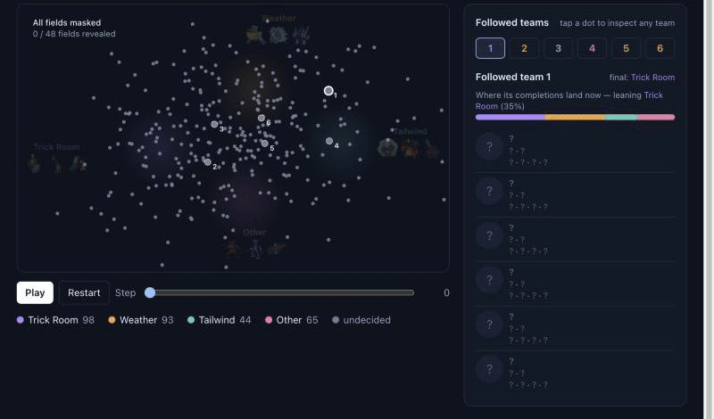

# Battle Factory of Porygon-Pi

[](LICENSE)
[](code/README.md)
[](https://rami-ismael.github.io/Battle-Factory-of-Porygon-Pi/blog/beating-the-meta-pokemon-vgc/)
[](https://github.com/Rami-Ismael/Battle-Factory-of-Porygon-Pi/actions/workflows/pages/pages-build-deployment)

Searching the space of competitive Pokémon VGC teams (Champions Reg Set M-B) for teams that beat a meta, using a diffusion proposer, a battle simulator and a surrogate.

**Result (2026-10-08).** The best team the search found wins 0.667 of simulated battles against the 50 top-placing meta teams, within noise of the best real team (0.691, standard error about 0.03). Across the 16 best finalists the average is 0.581, so the search reaches the level of real teams but has not beaten them.

*Win rate = wins ÷ battles against those 50 teams, one battle per pairing, with the same behaviour-cloned battle policy piloting both sides. A top-50 team scores 0.531 against the other 49. Source: [`code/docs/cem-v3-loop.md`](code/docs/cem-v3-loop.md).*

**[Random noise to Pokémon team archetypes](https://rami-ismael.github.io/Battle-Factory-of-Porygon-Pi/notes/Blog/visuals/archetype-diffusion/archetype-diffusion.html)** — latest artifact revision, 2026-10-12.

[](https://rami-ismael.github.io/Battle-Factory-of-Porygon-Pi/notes/Blog/visuals/archetype-diffusion/archetype-diffusion.html)

**[Try it live](https://rami-ismael.github.io/Battle-Factory-of-Porygon-Pi/notes/Blog/visuals/archetype-diffusion/archetype-diffusion.html):** play or scrub through 48 decoding steps and select any of 300 model-generated teams. Track its stable name and six-member roster as masked fields are revealed, inspect overlapping weather, Trick Room and Tailwind cues, or toggle mean-only positions and the selected team's path. The GIF above is a historical preview; the interactive page contains the latest controls. You can also download the [standalone HTML](notes/Blog/visuals/archetype-diffusion/archetype-diffusion.html) and open it offline.

The model starts from masked categorical fields. The Gaussian cloud illustrates estimated completion uncertainty, and the four-color map uses supervised archetype labels; it does not discover natural clusters or measure strategic similarity. The figure shows what the model generates, not how well those teams play. See the [artifact notes and verification](notes/Blog/visuals/archetype-diffusion/README.md) for the sampling method, strategy definitions and limitations.

| Folder | What it is |
| --- | --- |
| [`notes/`](notes) | The research notes: Markdown, Obsidian-flavoured (`[[links]]`), plus the daily posts and the interactive figures. |
| [`code/`](code) | The pipeline: team generator, battle runner, search loops, GUI. Start at [`code/README.md`](code/README.md). |
| [`blog/`](blog) | The main blog article, [Beating the Meta](blog/beating-the-meta-pokemon-vgc/index.html). Written in this repository and edited in place. |
| [`tools/sync.py`](tools/sync.py) | Copies both folders from the author's laptop and pushes. |

## Where the truth lives

The source of truth is the Obsidian vault and the code folder **on the author's laptop**. This repository is a published mirror of them, one-way:

```
Obsidian vault  ──sync──▶  notes/
code folder     ──sync──▶  code/
```

An edit in Obsidian shows up here as the same edit in the next sync. An edit made on github.com is overwritten by that sync, so open a note locally instead.

`blog/` is the one folder edited in place. The sync stages only `notes/` and `code/`, so it never touches the article or publishes a half-written one.

Ignored files (`.obsidian`, virtual environments, battle results, files over 5 MB) never leave the laptop, so the large datasets under `code/` are not included.

```bash
tools/sync.py --dry-run   # show what would change
tools/sync.py             # mirror, commit, push
```

## Licence

Code is [MIT](LICENSE). The blog's prose and figures are [CC BY 4.0](https://creativecommons.org/licenses/by/4.0/). The Pokémon sprites come from [Pokémon Showdown](https://github.com/smogon/pokemon-showdown); Pokémon and its character names and images belong to Nintendo, Game Freak and Creatures, and neither licence covers them.

## Acknowledgements

[Pokémon Showdown](https://github.com/smogon/pokemon-showdown) for the battle simulator, [VGC-Bench](https://github.com/cameronangliss/VGC-Bench) for the behaviour-cloned policy and the scraped teams, and [poke-env](https://github.com/hsahovic/poke-env).
