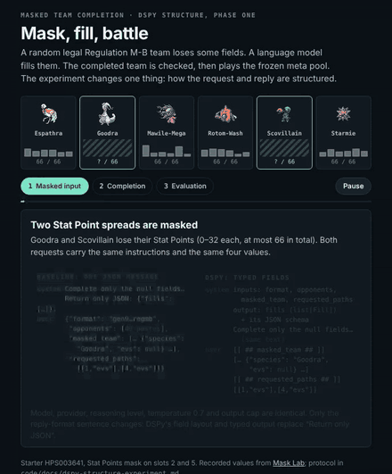

# DSPy structure experiment

Does packaging the masked-completion request as typed DSPy fields, with a typed
answer, change how often answers are legal and how well the legal teams play?



[Interactive version](../../blog/dspy-structure/index.html). It shows a real starter and mask, a recorded unreadable baseline answer, and a recorded legal answer with its 50-battle panel.

## Status, 14 October 2026

| Part | State |
|---|---|
| Phase one harness (structure only, no optimization) | Built and tested offline |
| Phase one paid run and battles | **Not run.** Needs the laptop runtime |
| Phase two harness (DSPy optimization) | Built and tested offline |
| Phase two run | Not run; follows phase one |
| Headroom from published data | Measured, below |

There are no win-rate results yet. Nothing below stands in for them. The run needs `OPENROUTER_API_KEY`, network access to `openrouter.ai`, the pinned Showdown validator, the behaviour-cloned battle checkpoint and the finished baseline folders in `code/results/`. All of these live on the author's laptop.

## What stays fixed and what changes

The comparison mirrors two finished baseline studies run for run: Ling 3.0 Flash with reasoning off and on (`reasoning-expanded-20261012`), and Mercury 2.5 with reasoning off, low, medium and high (`mercury-reasoning-20261013`). Both use the same 20 random legal starters × 7 masks (largest size per mask family) × 3 repeats = 420 requests per setting.

| Kept identical | Changed |
|---|---|
| Model, provider route, reasoning setting, temperature 0.7, output cap | How the request is packaged |
| Starters, masks, repeats, frozen opponent pool | How the reply is parsed |
| Instruction text, apart from the reply-format sentence | |
| Every input value: format, 49 opponent pastes, masked team, requested paths | |
| Completion checks (`apply_completion`) and the Showdown validator | |
| 50-battle panel, opponent schedule, behaviour-cloned policy on both sides | |

**Request.** `dspy_structure.py` turns each key of the baseline's JSON user message into a named, typed DSPy input field. The answer becomes one output field, `fills: list[Fill]`, and DSPy shows its JSON schema to the model. A `Fill` is a path plus a string, a Stat Point spread or a whole Pokémon. The instructions are the baseline system text with only these reply-format sentences removed (DSPy's layout replaces them):

- `Return only JSON: {"fills":[{"path":[0,"item"],"value":"..."}]}.` and `No prose or Markdown.` (original and regulation-reference prompts)
- `Return only strict JSON …` and `Use double-quoted keys and strings. No comments, …` (grounded prompt)

`check_information` re-reads every input field from the built request and fails unless it equals the baseline value. Preparation runs it on every task.

**Reply.** Two arms, both from DSPy 3.4.1:

| Arm | DSPy adapter | Reply layout |
|---|---|---|
| DSPy field-marker format | `ChatAdapter`, JSON fallback off | `[[ ## fills ## ]]` … `[[ ## completed ## ]]` |
| DSPy JSON-object format | `JSONAdapter`, no `response_format` | `{"fills": […]}` |

The typed parse is strict: `"12"` is not turned into `12`, and unknown keys are refused. DSPy does repair broken JSON (a trailing comma, say). That is part of the treatment, so each record stores `strict_json`, whether the model's own text parsed as written. The report counts answers that were legal only after this repair. No DSPy LM call, retry, fallback call or optimizer runs in phase one. Requests still go through `openrouter_generation.py`, with request hashes, pending markers and saved raw replies.

An optional third arm, `--resample-baseline`, sends the unchanged baseline request again alongside the structured ones. Its request hashes equal the originals. It separates the structure effect from provider drift since 12–13 October.

## Headroom in the published data

A reply format can only fix answers that failed on format. The Mercury 2.5 baseline rows in `blog/mask-lab/data.json` classify as follows (`dspy_structure_experiment.py headroom`):

| Mercury 2.5 reasoning | Legal | Unreadable answer | Wrong answer shape | Stat Points out of range | Rule violation | Legality if every format failure were fixed |
|---|---:|---:|---:|---:|---:|---:|
| off | 119 / 420 (28.3%) | 72 | 48 | 18 | 163 | at most 56.9% |
| low | 127 / 420 (30.2%) | 37 | 49 | 22 | 185 | at most 50.7% |
| medium | 141 / 420 (33.6%) | 42 | 16 | 25 | 192 | at most 47.4% |
| high | 155 / 420 (36.9%) | 20 | 1 | 36 | 206 | at most 41.9% |

Unreadable means the JSON did not parse. Wrong answer shape means a wrong fill count, or a duplicate or unmasked path. Not shown: 5 replies with no answer and 1 cut off. These are upper bounds: a fixed format still has to pass the rules. Most rejections are rule violations, which structure alone does not address. The headroom shrinks as reasoning effort grows, so any legality gain should be largest with reasoning off. The Ling studies' published summaries do not keep failure messages.

## Analysis, fixed before the run

Pairs match on model, reasoning setting, mask and repeat. Each difference is structured minus baseline.

- **Legality change**: all returned answers.
- **Win-rate change when both legal**: pairs where both teams passed and were scored. This is the win-rate comparison asked for, but it is conditional: a format that rescues hard masks changes which pairs are compared.
- **Wins delivered per request**: an illegal answer delivers no team and counts 0 wins. It is not counted as a battle loss. It is the one unconditional measure.

Intervals are 95% starter-cluster bootstraps with equal starter weights (`reasoning_experiment.cluster_interval`, 4,000 draws). Each interval comes with a two-sided starter-level sign-flip p-value. P-values are Holm-adjusted across all 12 model × reasoning × format cells. Verdicts: **improved** or **regressed** when the interval excludes zero; **no change beyond ±1 pp** (win rate) or **±5 pp** (legality) when the interval lies inside that margin; otherwise **unclear**. Pooled rows give each format's effect over every setting.

Expected precision: in the baseline studies, the both-legal win-rate differences between reasoning settings had 95% intervals about ±0.6 to ±0.9 pp wide per setting, with 94–101 pairs. Legal-team win rates are only 2–9%, so a real effect smaller than about 1 pp per setting will likely read as unclear.

The report refuses to compare when the battle configuration differs from the baseline's: same policy, simulator and panel fingerprints.

## Run phase one

On the laptop runtime, after `pip install dspy==3.4.1`:

```sh
PY=~/.local/share/vgc-pilot-runtime/venv/bin/python
$PY code/scripts/dspy_structure_experiment.py prepare --output code/results/dspy-structure-20261015 \
    --baseline code/results/reasoning-expanded-20261012 code/results/mercury-reasoning-20261013 \
    --adapters chat json --resample-baseline        # no calls; prints planned calls
$PY code/scripts/dspy_structure_experiment.py run --output code/results/dspy-structure-20261015
$PY code/scripts/dspy_structure_experiment.py battle --output code/results/dspy-structure-20261015 --workers 6 --watch
$PY code/scripts/dspy_structure_experiment.py report --output code/results/dspy-structure-20261015
```

Calls: 420 × 6 settings × 2 formats = 5,040, plus 2,520 for the re-sampled baseline. At the baseline's recorded cost ($0.98 for one pass of all six settings), expect about $3. Each structured request is about 2,200–2,500 characters longer (field list and answer schema); the 49 opponent pastes still dominate its length. Battles: the baseline had 810 legal answers per pass, so about 40,500 battles per format before exact-panel cache reuse. Generation and battles resume after interruption, as in the reasoning experiment.

## Legal-choice answer types

Phase one on Mercury 2.5 (14 October) found the structure removed format failures but not illegal answers. Unreadable answers with reasoning off fell from 72 to 0–2, while out-of-range Stat Points rose from 18 to 60 and rule violations from 163 to about 230. Most rejections were moves a species cannot learn (about 770 per format) and abilities it cannot have (about 500), followed by duplicate items (about 170) and Stat Point totals above 66.

`prepare --constraints legal-choices` keeps the inputs and instructions and replaces the answer type. Each requested path gets its own typed field, limited to what the regulation allows there (`dspy_structure.legal_completion_type`, from `data/regmb-vocabulary.json`):

| Path | Allowed values |
|---|---|
| ability | the species' abilities that pair with the slot's fixed item |
| item | items that pair with the slot's fixed ability, minus items fixed teammates hold |
| move | the species' learnable moves, minus moves already in the slot |
| nature | the 25 natures |
| Stat Points | each stat 0 to 32, plus a required `total` (schema maximum 66) that is dropped before checking |
| whole Pokémon | species not already on the team, items no teammate holds, any regulation ability and move; species-specific legality is stated, not enforced |

A value outside these choices fails the typed parse. The report counts it as a rule violation, not an unreadable answer. Choices that depend on the model's other answers (two masked items, a whole slot's moves for the species it picks) are only described. Requests grow 16–18% on average.

Offline, 88% of phase one's failed structured answers contain a value these types forbid. That is the ceiling: without constrained decoding the model can still answer outside the choices, so only a run measures the effect.

**Measured, Mercury 2.5, 15 October 2026** (`dspy-legal-choices-20261015`, 5,040 calls, $2.35). Legality improved in all eight model × format cells, Holm p < 0.01 each:

| Reasoning | Field-marker | JSON-object | Baseline prompt resampled |
|---|---|---|---|
| off | +17.6 pp [+14.0, +21.2] | +18.1 [+15.2, +20.7] | −1.9 [−5.2, +1.4] |
| low | +16.0 [+12.6, +19.3] | +15.7 [+12.9, +18.6] | +0.7 [−1.9, +3.3] |
| medium | +32.9 [+27.4, +37.9] | +30.2 [+25.5, +35.2] | +0.7 [−3.6, +4.8] |
| high | +41.0 [+36.2, +46.0] | +34.5 [+29.8, +39.5] | +1.0 [−2.9, +5.0] |

Pooled legality rose from 32.3% to 59.1% (field-marker) and 56.9% (JSON-object). Against the resampled baseline the gains are similar (+15 to +40 pp), so this is not provider drift. Win rate when both answers are legal stayed within about ±1 pp. Wins delivered per request rose 2.1 pp [+1.7, +2.6] and 1.6 pp [+1.3, +2.0]. Remaining rejections are mostly rule violations at reasoning off and low (164–191 per cell): answers outside the offered choices, or rules a per-field type cannot express.

```sh
$PY code/scripts/dspy_structure_experiment.py prepare --output code/results/dspy-legal-choices-<date> \
    --baseline code/results/mercury-reasoning-20261013 --adapters chat json --resample-baseline --constraints legal-choices
```

## Phase two: optimization

`dspy_optimize.py` optimizes the structured program, then tests it through the same phase-one path.

1. `prepare` samples fresh legal starters (default 12 for training, 8 for development). They exclude the 20 test starters and every pool team, and use the largest mask per family. The parent run fixes model, provider, reasoning, sampling settings, prompt version and pool.
2. `optimize` runs GEPA (default; budget `light`) or MIPROv2 through `dspy.LM` on OpenRouter, with the same settings. The metric runs the unchanged checks. It scores 0 for an illegal answer and 1 for a legal one, and returns the exact rejection message as feedback. With `--battles`, a legal answer scores 0.5 + 0.5 × its 50-battle win rate. The output is `program.json`: instructions and demonstrations, development score before and after, and task-model cost.
3. Test: `prepare --program program.json` on the 20 test starters, then `report --reference <phase-one folder>`. The report pairs the optimized program with the baseline and with the unoptimized structure.

```sh
$PY code/scripts/dspy_optimize.py prepare --parent code/results/mercury-reasoning-20261013/off/r0 --output code/results/dspy-optimize-20261016
$PY code/scripts/dspy_optimize.py optimize --output code/results/dspy-optimize-20261016 --optimizer gepa --budget light
$PY code/scripts/dspy_structure_experiment.py prepare --output code/results/dspy-optimized-20261016 \
    --baseline code/results/mercury-reasoning-20261013 --adapters chat --program code/results/dspy-optimize-20261016/program.json
```

Optimization may rewrite the whole instruction text, including the regulation reference. Demonstrations repeat the 49-paste opponent list, so MIPROv2 uses none by default. The grounded prompt varies its input fields by task and is not supported.

**With legal-choice types** (`dspy_optimize.py prepare --constraints legal-choices`, GEPA only). Each task keeps its own typed answer while GEPA rewrites one shared instruction text. The predictor holds a generic signature whose instructions GEPA edits, and every call sends that task's typed signature with the current instructions. Two adapter changes apply during optimization only. A value outside the choices comes back as a refusal the metric reports with its reason (field, error code and value), instead of a parse error GEPA would only see as a format failure. No `response_format` is sent, matching the phase-one requests. On a dry run the optimizer's requests were byte-identical to the test path's for all 140 tasks. Test the result with `prepare --program <program.json> --constraints legal-choices`.

**Measured, Mercury 2.5, 15 October 2026.** GEPA `light` at reasoning off (`dspy-optimize-20261015`, 14 minutes, $0.52 in task-model calls) raised development legality from 44.6% to 53.6% (56 tasks, also used to pick the candidate). It kept the original instructions and appended rules from the refusals: no duplicate items, legal moves and abilities, Stat Points 0 to 32 summing to at most 66, and one Protect per Pokémon except support walls. On the 20 held-out starters (`dspy-optimized-20261015`, 1,680 calls, $0.82) it beat the 13 October baseline by +18 to +38 pp in every setting, but not the unoptimized legal-choice types: reasoning off +3.3 pp [−0.5, +7.4], low +2.1 [−1.2, +5.7], medium +1.2 [−1.9, +4.3], high −2.6 [−6.9, +1.9]. Win rate when both answers are legal: −0.1 to −0.3 pp, all intervals including zero. At this budget, optimization adds nothing measurable beyond the legal-choice types.

### A stronger reflection model

In the run above, Mercury wrote GEPA's candidate prompts itself (no `--reflection-model`). Three changes let another model write them:

- `--reflection-model openai/gpt-6-luna` runs on its own route (`reflection_lm_for`): no provider pin (the task's Inception-only route refuses other vendors' models), its own reasoning effort (`--reflection-effort`, default `high`), no temperature (reasoning models take none), 32,000-token cap. Mercury still answers every task with the baseline settings. The run records `reflection_lm_cost_usd`.
- With legal-choice types, GEPA uses `ShapeAwareProposer`. The reflection model otherwise sees only the instructions and example answers, never the typed answer schema. Each reflection example now carries its task's required answer shape (long value lists shortened to their size), and a standing note says the shape is fixed by the program and every Stat Points object keeps `total`.
- `--num-retries` (default 3) sets per-request retries with backoff for both models. Inception's shared pool rate-limited Mercury overnight; `--threads 1 --num-retries 8` rides out short bursts but not a sustained limit.

Same 140 tasks, GEPA `light`, reasoning off. Held-out legality against the unoptimized legal-choice types (20 starters, 1,680 calls each):

| Reasoning | Mercury writes | GPT-6 Luna writes, no answer shape | GPT-6 Luna writes, shape-aware |
|---|---|---|---|
| off | +3.3 pp [−0.5, +7.4] | +6.4 [+1.9, +11.4] | +3.6 [−0.2, +6.9] |
| low | +2.1 [−1.2, +5.7] | +5.0 [+1.0, +9.3] | **+6.0 [+2.6, +9.0]** |
| medium | +1.2 [−1.9, +4.3] | −7.4 [−11.2, −3.6] | **+7.6 [+2.9, +12.4]** |
| high | −2.6 [−6.9, +1.9] | −14.5 [−18.6, −10.2] | **+4.8 [+0.2, +9.0]** |
| Pooled legality | 60.1% | 56.5% | **64.6%** |

Without the answer shape, Luna generalized the original instruction "evs keys are HP,Atk,Def,SpA,SpD,Spe" into "do not add a `total` field". Answers that followed it failed the typed parse: 5% at reasoning off, 25% at high, where the model follows instructions most closely. With the shape shown, such failures fell to 1–2%. The shape-aware prompt (`dspy-optimize-luna4-20261016`; dev 46.4% → 53.6%; $0.71 Mercury + $0.20 Luna) is the best arm: pooled 64.6% against 59.1% for the unoptimized types and 32.3% for the 13 October baseline. Win rate when both answers are legal stayed within ±1 pp in every comparison.

## Limits

- The opponent pool is frozen and visible in every prompt. This measures in-pool performance, not held-out play or today's Regulation M-C meta.
- Showdown's RNG is not seeded. Repeats are not independent starters, and 20 starters bound the precision.
- The baseline was sampled on 12–13 October. Without the re-sampled arm, a difference mixes structure and provider drift.
- A shared failure classifier groups validator messages by text prefix. Ambiguous Stat Point failures (out of range, or a string instead of a number) stay in their own class.

## Files and checks

`code/scripts/dspy_structure.py`, `dspy_structure_experiment.py`, `dspy_optimize.py`, and two hooks in `code/src/llm_completion.py` (`completion_payload` and `validate_record` use DSPy only when a manifest declares `structure`). The baseline request bytes are unchanged.

```sh
python -m unittest discover -s code/scripts -p 'test_dspy_*.py'   # 17 tests; no API key or simulator
```
