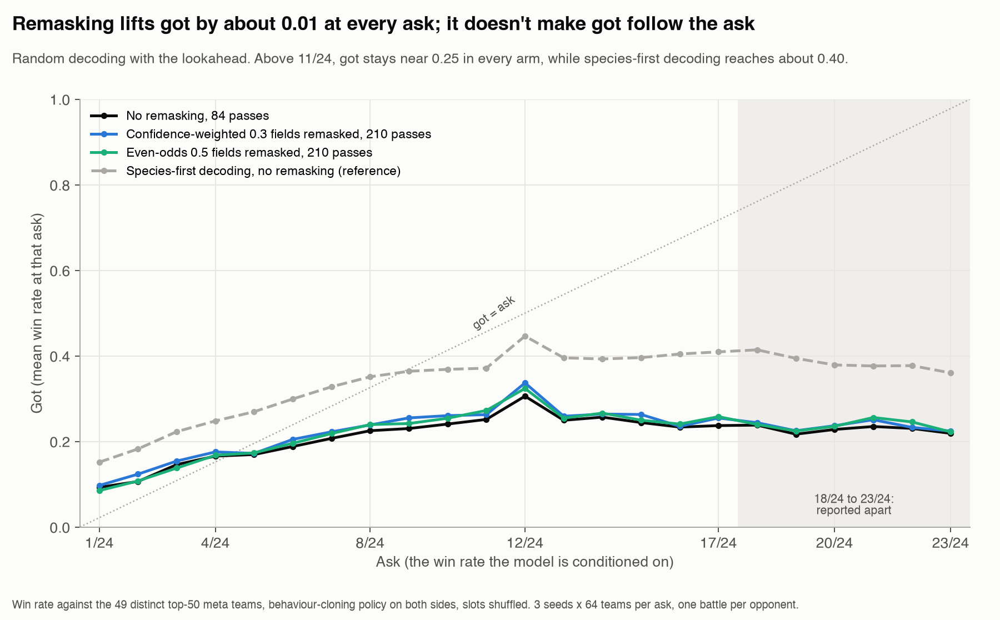
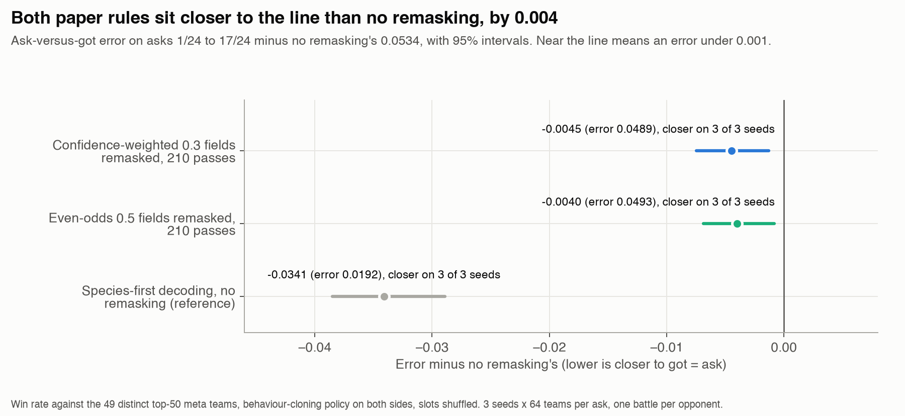

# Remasking on the all-teams 84-field model

Exploratory. The owner asked on 2026-11-01 what ReMDM does and whether it works on the 84-field model, and set the bar: the ask-versus-got slope should move closer to 1; a gain at the top asks is a bonus. Paper: Wang, Schiff, Sahoo and Kuleshov, [Remasking Discrete Diffusion Models with Inference-Time Scaling](https://www.alphaxiv.org/abs/2503.00307), NeurIPS 2025; its code: [kuleshov-group/remdm](https://github.com/kuleshov-group/remdm). Script: `src/remask84.py`. The 2026-10-30 run did not test the paper's selection rule, so its failure belongs to least-likely selection only.

## Contract

| Row | Value |
| --- | --- |
| Claim | Does remasking move ask-versus-got closer to the line, against the top-50 meta teams under the behaviour-cloning policy? The claim stops there. |
| Fields | All 84 generated, except that the repair replaces Stat Alignment, as in `ask_grid84.py`. Nothing copied. |
| Vocabulary | Unchanged from the checkpoint `stat84_all_teams_ep21.pt`; its coverage probe is in the grid's `preflight`. |
| Training teams | Unchanged: `lossdata84.npz` all-teams rows, 304,580 kept of 308,336, 2% validation. No training here. |
| Scorer | One battle against each of the 49 distinct top-50 meta teams, behaviour-cloning policy on both sides, slots shuffled, seed 7300 + sampling seed. |
| Search region | No loop. Species-first: each cell draws until 64 legal, non-held-out teams or 1,280 tries. Random decoding: 384 tries per cell, no stop at a number of legal teams, no battles yet. |
| Settings | Scientific: the remasking rule and decoding order. Nuisance: asks 4/24, 8/24, 12/24, 16/24, seeds 1 to 3. Fixed: guidance 2, temperature 1, rule masks. |
| Plan | Primary: ask-versus-got slope against no remasking, per seed, with and without 12/24. Bonus: win rate at the top ask. Reported beside them: species accumulation curves of line-ups and of line-ups at or above 0.531, and line-ups new against the fixed reference of 11,690. Species-first budget: 3 arms x 4 asks x 3 seeds x 64 teams x 49 battles = 112,896 battles, control reused. Random decoding budget: set after the probe. |

Ask 12/24 is read apart: it selects a different team population ([label noise protocol](label-noise-84-fields.md)).

## Arms, species-first decoding

Shared by every arm: all-teams 84-field model, 21 epochs, species first. Amounts are per pass. Queue: `~/vgc-data/remask84/rm84.zsh`.

| Reader name | Code ID | Rule |
| --- | --- | --- |
| No remasking, 84 passes | `plain` | Existing grid, `stat_points_84_gen84_all_ep21.json` |
| Least-likely 10% remasked, 84 passes | `remask_ll_10` | The 2026-10-30 rule: always the lowest-probability filled fields, redrawn in the same pass |
| Confidence-weighted 0.3 fields remasked, 210 passes | `remask_conf_loop` | The paper's confidence odds, 0.3 x exp(-p) / sum(exp(-p)), inside a 126-pass loop once 63 fields are filled; redrawn in the same pass |
| Even-odds 0.5 fields remasked, 210 passes | `remask_even_loop` | The paper's even odds, 0.008 per filled field, in the same loop; redrawn in the same pass |

## Random decoding legality probe

Sampling only, to set the try cap and battle budget. Shared by every arm: each masked field unmasks independently, as in the paper; a remasked field waits until the unmasking odds pick it. Queue: `~/vgc-data/remask84/rd84.zsh`, 3 arms x 4 asks x 3 seeds x 384 tries = 13,824 tries. Results: `remask84_random_decoding.json`, summarised under Result. A pass here is one step of the schedule; the saved counts, 84 and 210 per batch, match the arm names.

| Reader name | Code ID |
| --- | --- |
| No remasking, 84 passes | `rand_plain` |
| Confidence-weighted 0.3 fields remasked, 210 passes | `rand_remask_conf` |
| Even-odds 0.5 fields remasked, 210 passes | `rand_remask_even` |

## Random decoding with the lookahead (issue #92)

Pre-registered on 2026-11-06, before any battle. Exploratory: the budget below can't detect the 0.001 effect (see the noise floor at the end of this section).

Question: under random decoding, does either paper rule bring got closer to the ask than no remasking? The owner replaced slope with the ask-versus-got error on 2026-11-05, so this section judges the error alone.

Without the lookahead, 64 legal teams per cell would take 5,174 to 11,343 tries (issue #89), about 43 hours of sampling. With the lookahead from #205 on, a sampling-only pilot (seed 1, asks 8/24 and 16/24, 192 tries each) gave a legal share of 80% to 85% with no remasking, 84% to 85% confidence-weighted and 79% to 90% even odds. That fits the grid's existing cap of 1,280 tries, so every arm gets the species-first arms' budget per cell. The lookahead is a departure from the paper, shared by all three arms; the remasking rule stays the only scientific setting. The try cap and the lookahead are my choices; issue #91 records them for the owner.

| Row | Value |
| --- | --- |
| Claim | Under random decoding with the lookahead, a paper rule lowers the ask-versus-got error on asks 1/24 to 17/24 against no remasking. Refuted if the paired 95% interval of the difference does not sit below zero. If it holds, remasking becomes a candidate setting for random decoding in the search loop; if not, the failure section can say the paper's rules were tested and missed. The claim stops at win rate against the top-50 meta teams under the behaviour-cloning policy. |
| Fields | All 84 generated, except that the repair replaces Stat Alignment. Nothing copied. |
| Vocabulary, training teams | Unchanged: checkpoint `stat84_all_teams_ep21.pt`, no training. |
| Scorer | One battle against each of the 49 distinct top-50 meta teams, behaviour-cloning policy on both sides, slots shuffled, seed 7300 + sampling seed. |
| Search region | No loop. Each cell draws through `ask_grid84.draw`: until 64 legal, non-held-out teams or 1,280 tries. Asks 1/24 to 23/24, seeds 1 to 3. |
| Settings | Scientific: the remasking rule. Nuisance: ask and seed. Fixed: random decoding, lookahead on, guidance 2, temperature 1, rule masks, the loop schedule of the probe above. |
| Plan | Primary: ask-versus-got error on asks 1/24 to 17/24, each arm minus no remasking, 95% bootstrap interval over teams within each cell and opponents shared across arms, and seeds closer out of 3. Reported apart: the same error on 18/24 to 23/24. Reported beside: legal share as a cost, line-ups, line-ups new against training and records, species accumulation curves. Reference, not a control: species-first decoding without remasking, the 23-ask grid of the same checkpoint. Budget: 3 arms x 23 asks x 3 seeds x 64 teams x 49 battles = 649,152 battles. Smallest effect worth acting on: 0.001, the near-the-line threshold. No stopping rule: the grid runs to the end. Slope is not reported. |

Arms, all with random decoding and the lookahead on; amounts are per pass, as in the probe above. Queue: `~/vgc-data/remask84/la84.zsh`, frozen copy in `~/vgc-data/remask84/la_run/`, results `remask84_random_lookahead.json`, analysis `src/remask84_random_error.py` writing `remask84_random_error.json`.

| Reader name | Code ID |
| --- | --- |
| No remasking, 84 passes | `rand_la_plain` |
| Confidence-weighted 0.3 fields remasked, 210 passes | `rand_la_remask_conf` |
| Even-odds 0.5 fields remasked, 210 passes | `rand_la_remask_even` |

Probes: round trip and copies on 96 teams per arm at 8/24 (`remask84.py la_probes`); a failed round trip stops the queue. Coverage, controls, invariance, repeat and separation carry over from the grid, which uses the same checkpoint and scorer. No ceiling probe: the best case is an error of 0, so there is no perfect input to test. Condition: the grid itself shows whether got moves with the ask.

Noise floor: one ask has 9,408 battles per arm across seeds, so battle noise on its mean got is about 0.005. In the four-ask re-judge (#93), the paired interval on an error difference spanned about ±0.006. This grid averages 17 asks, so its interval should be narrower, though not down to 0.001. A difference under about 0.003 will likely stay undecided.

## Where the arms depart from the paper

| Setting | Paper and its code | Here |
| --- | --- | --- |
| Filled token | Kept unless remasked: the code's substitution step gives it probability 1 | Same |
| Unmasking order | Independent per token | Random-decoding arms match; species-first arms keep the fixed order |
| Draws in one pass | Independent, from one set of logits | One set of logits, drawn in fixed order so legality sees earlier draws |
| Remasked token | Back to the pool | Random-decoding arms match; species-first arms redraw in the same pass |
| Confidence in the loop | Text combines them; the code's text loop uses even odds only, and gives masked tokens zero odds under confidence, so they would stay masked while alpha is held | Masked fields unmask at 0.3 / masked count, which keeps the count level. My choice |
| Loop | t_on 0.25 with molecule guidance; T up to 4L | 63 of 84 fields filled; 63 + 126 + 21 = 210 passes |
| Even-odds value | 0.008, the best of three MAUVE settings on text | 0.008; no value published for this data |
| Legality | None | Rule masks at each draw, with the fallback to all values when none is allowed |

## Noise floor

One arm at one ask has 9,408 battles, so battle noise is about 0.005. Across four asks, 37,632 battles. A 0.03 gap needs about 4,400 battles per arm, so the budget can detect it. Three sampling seeds are the only repeat of generation, so sign agreement across seeds is reported beside each difference.

## Probes

Inherited from the grid, same checkpoint and scorer: coverage, training smoke (no training here), controls, invariance, repeat, separation. To run per arm: round trip, read teams, condition (asks change win rate), copies. `remask84.py check` proves the no-remasking path is bit-identical to `Model84.sample`.

## Result

### Species-first decoding

None of the three arms moves the slope closer to 1. Win rate is against the 49 distinct top-50 meta teams, behaviour-cloning policy on both sides, slots shuffled. Each arm has 768 teams and 37,632 battles. Differences are against no remasking, with a bootstrap interval over teams and opponents.

| Arm | Slope (difference, interval) | Slope difference by seed | Win at 16/24 (difference, interval) | Line-ups of 768 |
| --- | --- | --- | --- | --- |
| No remasking, 84 passes | 0.338 | | 0.404 | 438 |
| Least-likely 10% remasked, 84 passes | 0.239 (-0.099, -0.171 to -0.025) | -0.140, -0.045, -0.112 | 0.448 (+0.044, 0.015 to 0.076) | 228 |
| Confidence-weighted 0.3 fields remasked, 210 passes | 0.323 (-0.015, -0.091 to 0.059) | -0.056, +0.024, -0.014 | 0.416 (+0.012, -0.017 to 0.042) | 440 |
| Even-odds 0.5 fields remasked, 210 passes | 0.303 (-0.036, -0.110 to 0.036) | -0.084, -0.002, -0.021 | 0.391 (-0.014, -0.042 to 0.016) | 437 |

Without 12/24 the slopes are 0.291, 0.196, 0.287 and 0.251 in the same order. Least-likely selection misses the slope bar, gains win rate at every ask and loses line-ups, so it is a trade to weigh, not a plain failure. The paper rules keep 92% and 92% of the no-remasking line-ups (401 and 404 of 438). With species set first they have little to change, so random decoding is their real test.

Line-ups new against the 11,690 fixed reference: 335, 147, 333 and 333 in the same order.

Per-seed slopes, paired intervals, novelty and accumulation are in `remask84_slope_analysis.json`, written by `src/remask84_slope_analysis.py`. `remask84.py report` writes only the pooled slopes and curves, and it now leaves the fit empty until all four asks have battled.

### Random decoding

Legal share of 1,152 tries per ask, three seeds. All cells finished and the round trip passes on 20 of 20. These are few legal teams: 122 across 13,824 tries, a count that excludes held-out teams. Try cap and battle budget are still to be set in issue #91, so there is no slope yet.

| Arm | 4/24 | 8/24 | 12/24 | 16/24 | Mean |
| --- | --- | --- | --- | --- | --- |
| No remasking, 84 passes | 1.56% | 1.48% | 1.22% | 0.69% | 1.24% |
| Confidence-weighted 0.3 fields remasked, 210 passes | 0.95% | 0.87% | 1.04% | 0.52% | 0.85% |
| Even-odds 0.5 fields remasked, 210 passes | 0.43% | 0.61% | 0.87% | 0.35% | 0.56% |

### Random decoding with the lookahead (issue #92)

Both paper rules bring got closer to the ask than no remasking, and the bar set above is met. The gain is small: about 0.004 on an error near 0.05, which is 49 times the 0.001 that counts as near the line. Species-first decoding without remasking sits 0.030 closer than either rule. Exploratory, as pre-registered.

Arms, all with random decoding and the lookahead on. Win rate is against the 49 distinct top-50 meta teams, behaviour-cloning policy on both sides, slots shuffled. Each arm has 4,416 teams (69 cells of 64) and 216,384 battles, none missing, one battle policy. The differences are paired against no remasking, with a 95% bootstrap interval over teams within each cell and opponents shared across arms.

| Arm | Error, asks 1/24 to 17/24 | Minus no remasking (interval) | Seeds closer | Error, 18/24 to 23/24 | Legal share | Line-ups |
| --- | --- | --- | --- | --- | --- | --- |
| No remasking, 84 passes | 0.0534 | | | 0.3977 | 83.6% | 2,220 |
| Confidence-weighted 0.3 fields remasked, 210 passes | 0.0489 | −0.0045 (−0.0075 to −0.0013) | 3 of 3 | 0.3883 | 85.9% | 3,439 |
| Even-odds 0.5 fields remasked, 210 passes | 0.0493 | −0.0040 (−0.0069 to −0.0008) | 3 of 3 | 0.3858 | 83.4% | 2,470 |
| Species-first decoding, no remasking (reference) | 0.0192 | −0.0341 (−0.0385 to −0.0289) | 3 of 3 | 0.2291 | 100% | 881 |

On 18/24 to 23/24 both rules' intervals cross zero (−0.0240 to +0.0044 and −0.0258 to +0.0013).

Mechanism: remasking lifts got about evenly, by 0.012 (confidence-weighted) and 0.008 (even odds) averaged over the 23 asks. In every random-decoding arm got stops rising at 11/24 and sits near 0.25 from 13/24 up, and asks 13/24 to 17/24 make up 82% to 85% of each arm's error. A level lift closes part of that undershoot; nothing here makes got follow the ask.

Diversity: confidence-weighted remasking gives 3,439 line-ups against 2,220 with no remasking, and shares 1,152 of them with it. Line-ups at or above the elite cut of 0.531 on their single scoring, not re-battled: 15 with no remasking, 26 confidence-weighted, 23 even odds, 64 species-first. Line-ups new against both the training teams and the loop and tournament records: 1,992, 3,088, 2,246 and 400.

What this can't show:
- The lookahead is not in the paper. All three arms share it, and species-first decoding draws the same rows with it on or off (#205), but the paper's rules without it would need about 43 hours of sampling and remain untested.
- No team was picked from these battles, so the error carries no selection bias. The elite-cut counts come from one 49-battle scoring each and would shrink on fresh battles.
- One checkpoint, one battle policy, one opponent set.

Deviations: the queue ran with the laptop lid closed on battery for part of sampling, so macOS slept it; one cell took 9,055 s instead of about 60 s. Teams are unaffected. After pre-registration, and before any battle, the analysis switched from the shared four-ask error helper to a plain mean of squared gaps, because the helper scores only asks 1/24 to 17/24 and returned nothing for 18/24 to 23/24. On 1/24 to 17/24 the two are identical.

Files: `remask84_random_lookahead.json` (teams, tries, battles), `remask84_random_error.json` (errors, intervals, novelty, contract), both in `~/vgc-data/results/`. Code: `src/remask84.py` (`la_*` steps), `src/remask84_random_error.py`, `src/remask84_random_figures.py`. Queue log: `~/vgc-data/remask84/la84.log`.

### Provenance

The results came from the frozen copy in `~/vgc-data/remask84/run/`. The script here differs from that copy in the report's guard on partial grids and a lint refactor of `sample`; on a stand-in network, both copies draw identical teams in every species-first arm. `ask_grid84.py` and `diffusion84.py` here are newer than the frozen copies; their changes add label noise, off-grid asks and a checkpoint guard, and leave `Model84.sample` as it was.

### Pilot before the battles

Sampling-only pilot, seed 1, 64 legal teams per cell, kept under its earlier code IDs in `remdm84_pilot.json` (`remask10`, `remdm_conf`, `remdm_cap`). After seeing it, the owner set the slope as the bar, and I renamed the arms and added random decoding. Line-ups out of 64 at asks 4/24, 8/24, 12/24, 16/24:

| Arm | Line-ups | Exactly 66 Stat Points |
| --- | --- | --- |
| No remasking, 84 passes | 59, 38, 61, 26 | 27%, 27%, 28%, 25% |
| Least-likely 10% remasked, 84 passes | 34, 10, 42, 9 | 62%, 67%, 45%, 57% |
| Confidence-weighted 0.3 fields remasked, 210 passes | 59, 38, 61, 26 | 27%, 29%, 27%, 24% |
| Even-odds 0.5 fields remasked, 210 passes | 59, 38, 61, 26 | 26%, 27%, 25%, 27% |

Probes on 96 teams at ask 8/24 pass: round trip 20 of 20, no team identical to a training team, at most 2 shared slots with the nearest one.
