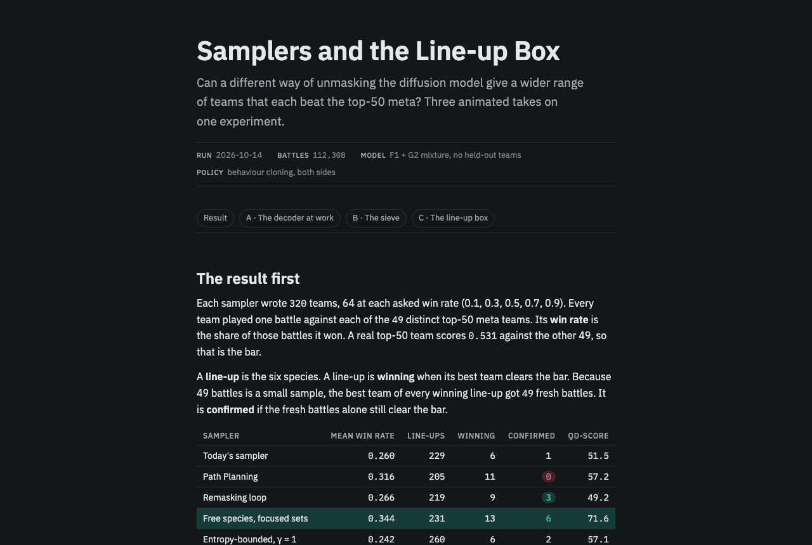
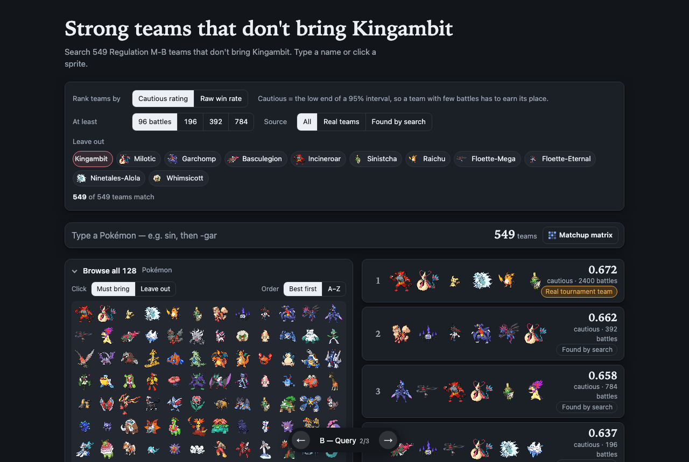
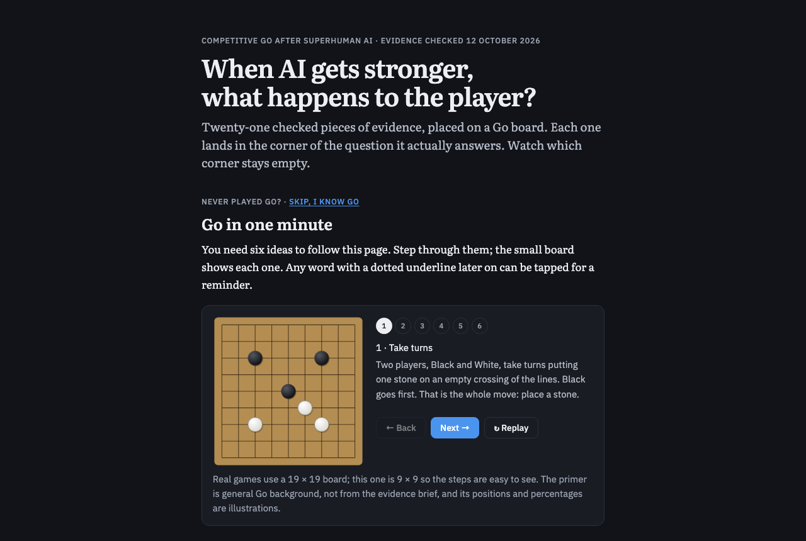

At my request, Claude deleted the AI-written ReadMe section from my [public-repository note](<../Create a public repository for this project with a runnable README.md>): a repo checklist, bad-list reasons, a retired-sections list, a master checklist and an anti-patterns line. Only my own sections remain. After I compared our README with metamon's, Claude added a table of contents and install steps in [PR #22](https://github.com/Rami-Ismael/Battle-Factory-of-Porygon-Pi/pull/22), because ours linked results but gave no path to running anything.

I questioned why the cross-entropy loop's best team gave Sylveon a Mental Herb when real Sylveon players hold Fairy Feather on 87 of 101 teams, and I started a [source-of-error note](<../Write up a source of error you notice on 2026-10-14 when my cross entropy method state the best pokemon team had pointless item.md>) about it. Claude found that Mental Herb does fire (22 times in 2,352 battles); the plainly dead item was Basculegion's Never-Melt Ice, with no Ice move. Claude then traced the item field through each stage of the loop:

| Stage | Effect on never-firing items |
|---|---|
| Training corpus | *Brings them in*: 86% of 146,994 teams, against 0.3% of 681 real teams |
| Generator's first proposals | Keeps them: 85% |
| Showdown legality check | Keeps them: it checks legality, not whether an item can work |
| Surrogate ranking | Keeps them: 84% of its picks; it weighs an item the same whatever Pokémon holds it |
| Battles | *Cannot see them*: removing Sylveon's item moved win rate by +0.013 [−0.019, +0.044] |
| Elite selection | Keeps them: the direction flipped between two runs |

Mental Herb reached Sylveon by chance: it sits on 0.3% of Sylveon slots in the corpus, landed on a team that drew a lucky 49-battle score, and training on top teams copied the whole team, item included. Under our behaviour-cloning battle policy, Fairy Feather did no better than Mental Herb, and no item swap moved win rate by more than about 0.04. I see this as a failure of the search, not a verdict on the item: the result holds only for this policy, and the loop's surrogate wrongly ranked Mental Herb as the better outcome. My note concludes that we need our own policy without this bias. Claude's charts were inline only, so I have no link for them.

In the morning, I asked Claude for a lead sentence on the loop's strongest result, with a subagent checking every number. It quoted a 0.581 finalist mean and showed that the 0.8-range scores I had seen from Codex were single 49-battle search labels, not fresh battles. I then had it re-run the loop with models that never saw ranks 51–100. The clean finalists scored *0.504* against the top 50 and 0.509 against those held-out teams, per the [loop write-up](/Users/ramiismael/Documents/code/vgc-team-generator-pilot/docs/cem-v3-loop.md). The earlier 0.581 came from models that had seen the winning teams; with one seed each, leakage and run-to-run noise cannot be fully separated. Claude added a data-separation banner to 20 published pages, each linking a [held-out walkthrough](https://claude.ai/artifact/Luj92wuAwJCBoiACrKq5DH) (private).

I asked whether different samplers could widen the range of strong teams. Of seven samplers, each battling 320 teams, only sets-only temperature 0.5, which sharpens set choices while leaving species free, raised quality-diversity; Path Planning's extra winners did not hold up in fresh battles, and entropy-bounded unmasking added only weak line-ups. Claude explained this in [Samplers and the Line-up Box](https://claude.ai/artifact/CR7KA2M123txRKSvpCY7Uj) and [Sets-Only Temperature](https://claude.ai/artifact/KTmqsu73BB8wsxEuV38Kx9) (both private). Claude also swept diversity-in-diffusion papers from top venues and added 12 to a [Reading List copy](</Users/ramiismael/Documents/yakumsi-vault/Personal Project/Using Advance method search in the whole search of possible vgc pokemon format to find the right counter to a pokemon team/.claude/worktrees/diffusion-diversity-research-2532e1/notes/Papers/Reading List.md>) that is not yet in the vault; all seven Haiku sweepers thrashed, so the main agent ran it.

*[Samplers and the Line-up Box](https://claude.ai/artifact/CR7KA2M123txRKSvpCY7Uj) (private), rendered from its October 14 source: free species with focused sets confirmed 6 winning line-ups; Path Planning confirmed none of its 11.*

The DSPy test of whether request structure alone changes LLM-built teams completed for Mercury only; the [report](</Users/ramiismael/.codex/worktrees/519e/Using Advance method search in the whole search of possible vgc pokemon format to find the right counter to a pokemon team/code/results/dspy-structure-20261014-mercury/report.md>) shows no win-rate change beyond ±1 point. Ling stayed blocked by provider errors and rate limits. That evening I asked Claude to [replace the scratch model with a fine-tuned pretrained text diffusion model](<../Replace the scratch model with a pretrained text diffusion model finetune it to do your task.md>); by midnight two of its arms scored 0.454 and 0.460 one-shot against the scratch model's 0.378, with the full comparison still running.

Codex finished all 101,506 win-rate labels, then traced a stalled v4 battle worker to a wait that never ended after its connections closed on a keepalive timeout. I approved replacing only the 16 interrupted battles, and at my request Codex moved v4 to the six-worker pipeline. v4 then stopped at 15:40 on a missing checkpoint, leaving the DiBO diversity run unstarted. Codex's [optimization audit](/Users/ramiismael/Documents/code/vgc-team-generator-pilot/results/optimization-audit-20261014-cpu/report.md) passed on CPU, but the speedups stay off until verified on GPU. Claude made fast battles the default everywhere in [PR #21](https://github.com/Rami-Ismael/Battle-Factory-of-Porygon-Pi/pull/21) and [PR #23](https://github.com/Rami-Ismael/Battle-Factory-of-Porygon-Pi/pull/23), about 2× faster with matching win rates, because I no longer want old benchmarks bottlenecked by simulation. Codex pushed review fixes to [PR #18](https://github.com/Rami-Ismael/Battle-Factory-of-Porygon-Pi/pull/18), which stays open.

I wanted something to show on LinkedIn, so Claude built the [Kingambit-Free Team Finder](https://rami-ismael.github.io/Battle-Factory-of-Porygon-Pi/blog/kingambit-finder/) with token search, a sprite wall and a matchup matrix ([PR #19](https://github.com/Rami-Ismael/Battle-Factory-of-Porygon-Pi/pull/19), [PR #20](https://github.com/Rami-Ismael/Battle-Factory-of-Porygon-Pi/pull/20)). I picked the merged design after four subagents tried different search ideas. I also decided to restructure Mask Lab as my own lab page, ordered by the questions I asked; Claude [rebuilt it](</Users/ramiismael/Documents/yakumsi-vault/Personal Project/Using Advance method search in the whole search of possible vgc pokemon format to find the right counter to a pokemon team/.claude/worktrees/subagent-claim-verification-ad08f4/blog/mask-lab/index.html>) with the new study exported and all seven fills stacked; the vault copy is not yet updated. My favourite archetype page, [noise to team archetypes](https://claude.ai/artifact/9rsGMnwsEEmNszeW3FxsSe) (private), gained motion chosen part by part by a judge subagent; I required the subagents to run on Haiku only.

*The [Kingambit-Free Team Finder](https://rami-ismael.github.io/Battle-Factory-of-Porygon-Pi/blog/kingambit-finder/) as published that day: 549 Regulation M-B teams without Kingambit, ranked by a cautious rating.*

On framing, I practised in a [writing workshop](../artifacts/writing-workshop-vgc-framing-20261014-7b92.html) presenting VGC as a noisy black-box optimization benchmark; Codex pushed me to separate the benchmark, the method and the hoped-for wider meta. Claude mapped my [blog outline](../Blog.md) and created eight frontmatter-only section notes, including [the cost section](<../The bill behind every number, battles and dollars and hours.md>), which it advised placing after the noise section. Claude rebuilt Codex's brief on AI and players as [When AI gets stronger](<visuals/ai-and-the-player/index.html>), adding cited pins on Brown's chart and a Go primer because I don't know Go's rules. It also turned the brief, which found neither harm nor benefit to players established, into a lesson, [Does Strong AI Spoil VGC?](https://claude.ai/artifact/C3RpJnfQjaqKK11ZEz6EKL) (private), comparing VGC with Scrabble.

*[When AI gets stronger](<visuals/ai-and-the-player/index.html>) opens with the Go primer Claude added for readers who don't know Go.*

For a Hugging Face battle demo, I chose a v1 scope: a random team against `RandomPlayer`, with behaviour cloning in v2. Claude found that Docker Spaces need a paid plan and built a [Gradio team-draw prototype](</Users/ramiismael/Documents/yakumsi-vault/Personal Project/Using Advance method search in the whole search of possible vgc pokemon format to find the right counter to a pokemon team/.claude/worktrees/huggingface-pokemon-battle-space-839b7f/code/space/prototype_team_draw/app.py>) drawing from the top-50 pool; battling is still a stub.

On tooling, I marked three Pstack skills as not interesting in Codex because they overlap ones I have, then had Claude port my 11 selected skills and update the [skills report](../pstack-audit/index.html). Claude added automatic unslop and skills-report sync rules to my [global Claude instructions](/Users/ramiismael/.claude/CLAUDE.md). Codex extended my [goal-restatement prompt](../goal-restatement-prompt.md) to search Claude Code and Codex histories first, and updated this blog's prompt to allow visuals. Claude compared that prompt with the posts from 10 to 13 October and found eight improvements, led by a dropped "name the decision" line; the prompt was not changed then.
