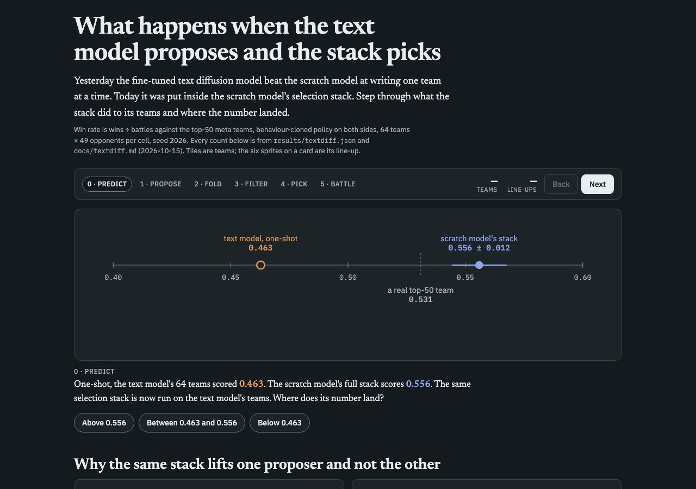
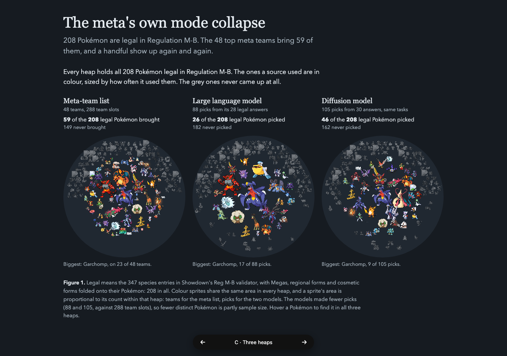
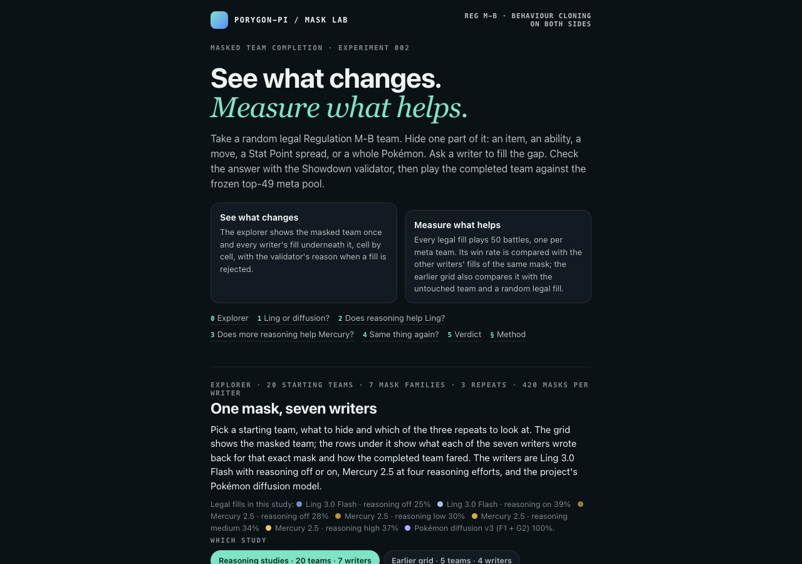

I suspected the Mental Herb bug came from the battle policy using Sylveon poorly, so I asked Claude to test whether Fairy Feather would knock out more Pokémon. Over 1,176 battles per version against the 49 top-50 meta teams, Fairy Feather added about 0.08 knockouts per battle [−0.01, +0.17] but no wins (−0.017 [−0.051, +0.019]). The policy plays Sylveon passively: only 58% of its moves are attacks. The bigger find was *slot order*: the same six Pokémon won 0.710 written alphabetically and 0.651 with Sylveon first, a gap of +0.059 [+0.022, +0.095], because the policy tends to leave slot 1 at home. That matters beyond one team, since the matchup database battles every team in alphabetical order. This result lives only in the chat; there is no write-up to link. Earlier that day I had listed a LinkedIn post about the policy's Sylveon weak spot in my [sharing note](<../Spreading my work to the global internet.md>).

On keeping generated line-ups diverse, three pre-registered arms failed and one passed. Lowering species guidance to 1 widened line-ups from 148 to 274 per 512 but lost −0.013 win rate, a near miss on the −0.03 bound; CADS condition noise reached 388 line-ups but lost −0.034. Porting batch repulsion on species-presence vectors moved line-ups only within noise, and a three-seed check [did not replicate](/Users/ramiismael/Documents/code/vgc-team-generator-pilot/docs/species-repulsion-replication.md) (11 vs 10 confirmed winners). The middle setting, species guidance 1.5, *passed*: about +50 line-ups in every seed at +0.001 [−0.026, +0.027] win rate, per the [guidance write-up](/Users/ramiismael/Documents/code/vgc-team-generator-pilot/docs/guidance-timing-cads.md). The next step is to try it inside the cross-entropy loop.

I asked Claude to finish the pretrained text diffusion comparison. Writing one team at a time, the fine-tuned Fast-dLLM v2 scored 0.463 against the scratch model's 0.378, but with 79–88% legality and fewer distinct line-ups. Inside the scratch model's selection stack it fell to 0.491 against 0.556, worse by the rule we fixed beforehand; the surrogate pick kept only 4 line-ups. On the Mask Lab grid it filled 149 of 270 masks legally, level with the scratch decoder where legal. Results are in the [text diffusion write-up](/Users/ramiismael/Documents/code/vgc-team-generator-pilot/docs/textdiff.md), and Claude made a predict-then-reveal [step-through](https://claude.ai/artifact/HB3FbC4TnQB1EJHT5CUBjd) (private) for me. That evening Claude cut its training time from 9.75 to about 6.0 seconds per step with the same loss.

*The [step-through](https://claude.ai/artifact/HB3FbC4TnQB1EJHT5CUBjd) asks where the text model lands before revealing 0.491.*

The DSPy work found that structure alone had turned unreadable answers into rule violations. I asked Claude to restrict each answer to choices Regulation M-B allows. These legal-choice types raised Mercury's legality from 32.3% to 59.1% (+26.8 points [+24.4, +29.2]) with win rate unchanged. GEPA prompt optimization with Mercury reflecting on itself added nothing measurable. I suspected the weak reflection model, so Claude reran with GPT-6 Luna: +6.4 and +5.0 points over the legal-choice types at reasoning off and low, but losses at medium and high because its prompt told Mercury to drop a required field. Claude fixed what the reflection model sees; the rerun has not happened yet. The first two phases merged as [PR #25](https://github.com/Rami-Ismael/Battle-Factory-of-Porygon-Pi/pull/25).

I was struggling to see how [Diffusion-BBO](<../Papers/Diffusion-BBO Diffusion-Based Inverse Modeling for Online Black-Box Optimization.md>) optimizes and how it differs from my cross-entropy loop. Three subagents read it, and Claude checked their reports against the arXiv text. Our code already uses its 0.15 condition dropout. The real differences are that the paper retrains on all data rather than elites only, and it chooses the requested score each round. At my request, Claude wrote that as a 2 × 2 ablation with a source line under each item in [Ablation Experiments](<../Ablation Experiments.md>). Claude also researched [model-based optimization methods built from metaheuristics](</Users/ramiismael/Documents/yakumsi-vault/Personal Project/Using Advance method search in the whole search of possible vgc pokemon format to find the right counter to a pokemon team/.claude/worktrees/diffusion-bbo-paper-bf1fcf/notes/Papers/Model-based optimization methods built from metaheuristics.md>); its 23 papers are not yet in my Reading List.

For the blog, I drafted why I chose diffusion over a language model. Claude built a [writing workshop](</Users/ramiismael/Documents/yakumsi-vault/Personal Project/Using Advance method search in the whole search of possible vgc pokemon format to find the right counter to a pokemon team/.claude/worktrees/parallel-team-generation-ad59a3/notes/Teaching/writing-workshop-why-not-a-language-model.html>) and I revised the hook several times. My [diversity paragraph](<../One reason for using diffusion over llm model is diversity.md>) argues that feedback tuning narrows model output. I also described the meta's own mode collapse, where players bring a few common Pokémon, and Claude turned that into a figure.

*[The meta's own mode collapse](https://claude.ai/artifact/EYiJbwVs21yBi6iRpobGd8) (private): the meta list brings 59 of 208 legal Pokémon; the model heaps use fewer picks.*

Claude also mapped my [blog outline](../Blog.md) again, added seven frontmatter-only section notes and a [text diffusion section](<../A pretrained text diffusion model won alone, then lost inside the search.md>), and corrected the Protect line in my [EDA note](<../EDA on meta pokemon team.md>). It flagged that its seven notes had reached the vault through the shell, past the worktree guard. Claude also wrote my [October 14 blog](<Blog for 2026-10-14.md>); after I pointed out it left out the Mental Herb cause, I had Claude raise the blog limit to 8,192 characters and expand it.

I told Claude a ChatGPT edit had damaged Mask Lab's layout and text. Claude rebuilt it with the hero first, an explorer showing every writer's fill under one mask, my four questions in order, and a new fill-diversity question. It now covers the 20-starter study (420 masks × 7 writers). The [rebuilt page](https://claude.ai/artifact/BHnAai6APQf1RVFgFydR63) (private) is committed on a branch but not pushed.

*The rebuilt [Mask Lab](https://claude.ai/artifact/BHnAai6APQf1RVFgFydR63) opens on its two goals and the explorer.*

For the Hugging Face demo, I rejected three polished Gradio designs and then the egg hatchery, because Champions teams are fully evolved. I chose the booster pack from Claude's [team-draw concepts](https://claude.ai/artifact/TQ561JWwPbQWdjgmsYgtpA) (private), now with held-item icons. Fast battles became the default on main through [PR #21](https://github.com/Rami-Ismael/Battle-Factory-of-Porygon-Pi/pull/21) and [PR #23](https://github.com/Rami-Ismael/Battle-Factory-of-Porygon-Pi/pull/23); with #23, 195 of 198 tests pass, none fail, and battles run 2.3× faster with matching win rates. After reading metamon's README, I had Claude expand our acknowledgements in [PR #24](https://github.com/Rami-Ismael/Battle-Factory-of-Porygon-Pi/pull/24), still open.
