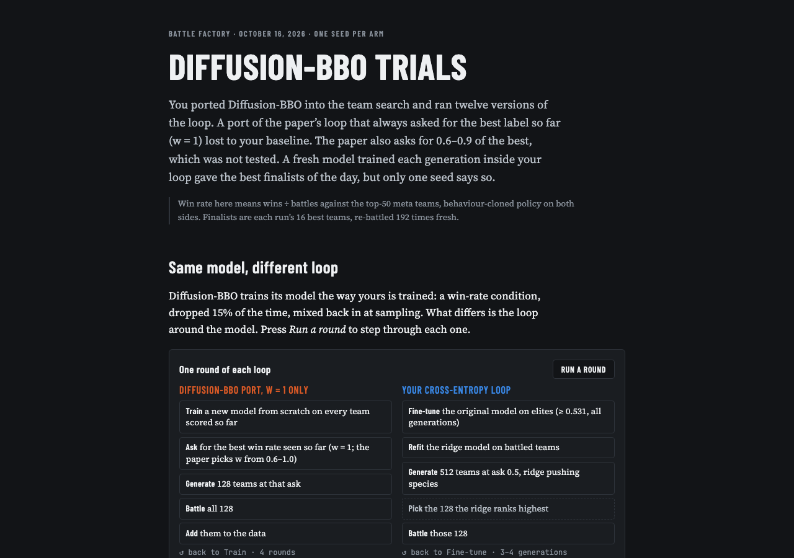
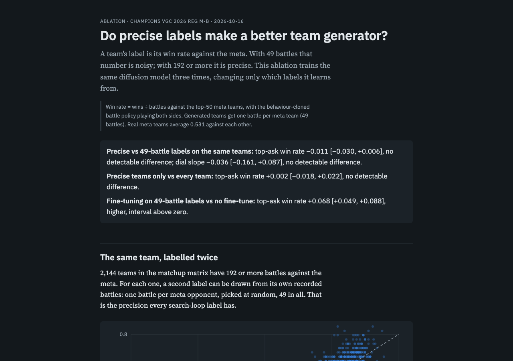
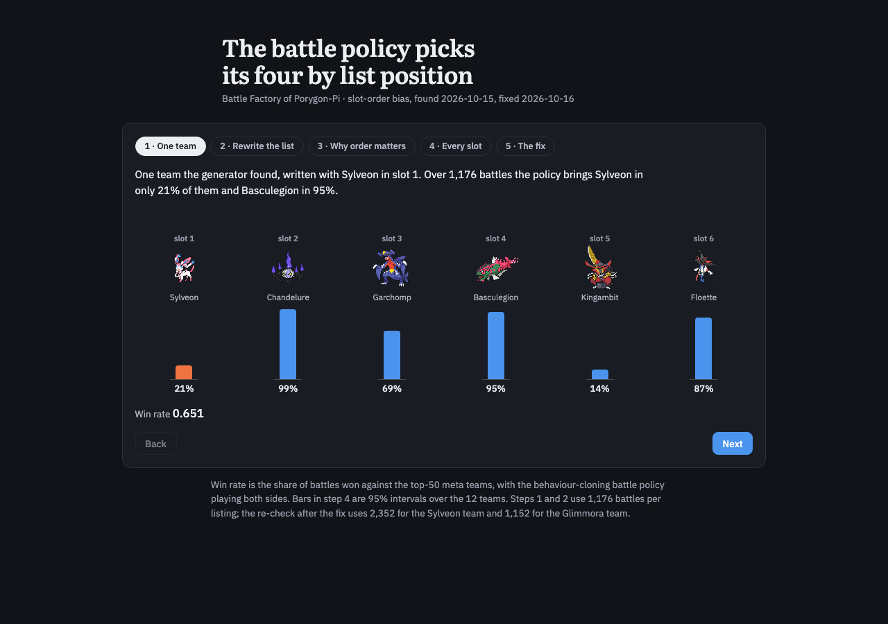

I rejected two papers, SPARROW and HADES, because their experiments are only continuous or toy studies with nothing like a team-shaped search space. With my explicit approval, Claude deleted the live HADES entry, a MED-graded line for "Heuristically Adaptive Diffusion-Model Evolutionary Strategy", from my [Reading List](<../Papers/Reading List.md>), keeping only its dated rejection. It then added that rule to the list's frontmatter, moved ten papers to LOW and, at my request, kept DiBO at MED because I'm reading it. It also rewrote the list as 52 tables. Claude had written a [SPARROW pre-registration](/Users/ramiismael/Documents/code/vgc-team-generator-pilot/docs/sparrow-port.md) that morning; it was never run. Among 99 papers citing four foundational ones, Claude found one applied paper on a discrete problem; an ACM bot check blocked it, so I had it graded MED from the abstract.

Most of the day went into why the requested win rate, the *ask*, does so little in my cross-entropy loop. I had wanted to replace my proposer with a score-conditioned inverse model like [Diffusion-BBO](<../Papers/Diffusion-BBO Diffusion-Based Inverse Modeling for Online Black-Box Optimization.md>)'s; Claude's [lesson](</Users/ramiismael/Documents/yakumsi-vault/Personal Project/Using Advance method search in the whole search of possible vgc pokemon format to find the right counter to a pokemon team/.claude/worktrees/diffusion-bbo-paper-bf1fcf/notes/Teaching/lessons/0012-your-proposer-is-already-the-inverse-model.html>) showed my proposer already is one. Claude also confirmed that my loop's elites are every labelled team ever at or above 0.531 plus meta anchors, not each generation's best as I had assumed. I banned "threshold" and asked Claude for a [vocabulary note](</Users/ramiismael/Documents/yakumsi-vault/Personal Project/Using Advance method search in the whole search of possible vgc pokemon format to find the right counter to a pokemon team/.claude/worktrees/diffusion-bbo-paper-bf1fcf/notes/CONTEXT.md>) defining *elite cut* and *ask*; it is not in the vault yet.

Claude then ran arm after arm, recorded in the [Diffusion-BBO write-up](/Users/ramiismael/Documents/code/vgc-team-generator-pilot/docs/cem-dbbo.md). A Diffusion-BBO-style arm, training on all data with a moving ask, scored 0.521 against the 0.504 baseline, within noise. Moving the ask alone, top-20% per-generation elites, and fixed asks of 0.6 to 0.8 also changed nothing. Without the loop, the model follows the ask from 0.1 to 0.5, then stalls near 0.50. I suspected a bug; Claude found none, and an [audit](/Users/ramiismael/Documents/code/vgc-team-generator-pilot/docs/cem-ask-training-audit.md) agreed. Precise labels lifted the no-loop ceiling to 0.59, and turning off the ridge push let the ask work inside the loop again, per the [ask-dial write-up](/Users/ramiismael/Documents/code/vgc-team-generator-pilot/docs/ask-dial.md). I proposed that the loop had turned the model into a forward model. Claude confirmed it: the elites-only model reads a team's win rate worst (r 0.46 against 0.83–0.84). A 2 × 2 test then showed that training across the full range makes even a fixed ask work, so elites-only retraining is the cause.

A fresh model trained each generation inside my loop scored 0.580, the day's best finalists but from one seed. I pointed out that always asking for the best label (w = 1) is not the paper's rule, which uses 0.6 to 1.0. Claude relabelled those runs as a variant; they [lost](/Users/ramiismael/Documents/code/vgc-team-generator-pilot/docs/dbbo-faithful.md) at 0.461 and 0.463. I queued the full paper rule as an exception to my 2026-08-29 decision.

*[Diffusion-BBO Trials](https://claude.ai/artifact/C3diQBkcNZX9FXkwnV4fAZ) (private) sets the w = 1 port beside my cross-entropy loop, one round at a time.*

In a separate session I asked for a label-precision ablation, since I assumed teams with 192 or more battles carry less noise. Fine-tuning on 49-battle labels beat no fine-tuning by +0.068 [+0.049, +0.088], but precise labels added nothing (−0.011 [−0.030, +0.006]). Re-battling 1,105 selected teams gave only +0.013, within noise. Training on labelled teams that cover the whole win-rate range is the lever, so a test of that spread is running, with its Why line in [Ablation Experiments](<../Ablation Experiments.md>).

*The [Label Precision Ablation](visuals/label-precision/index.html) puts all three comparisons up front.*

Species guidance 1.5, which passed one-shot on 15 October, [failed inside the loop](/Users/ramiismael/Documents/code/vgc-team-generator-pilot/docs/species-guidance-loop.md): it missed the line-up clause in one seed, at +0.002 win rate. Its three fresh plain-loop seeds scored 0.550 to 0.577, against 0.504 at the baseline seed, so the baseline itself varies by seed. I also accepted taboo's lower win rate for the chance to explore different Pokémon.

I asked Claude to test the slot-order effect properly. Across 12 teams in six rotated orders, 13,848 battles, slot 1 was brought 43% of the time and slot 5 51%, against about 80% for slots 2 and 3, because team preview picks slot numbers. Win rate moved much less (about 0.018 across orders, p = 0.057). Claude built a fix that shuffles each team before every battle but kept it out of staging while the ablation queue runs there. I copied its figure into the vault.

*[The battle policy picks its four by list position](visuals/slot-order/slot-order.html): written with Sylveon first, Sylveon is brought in 21% of battles.*

GEPA with GPT-6 Luna reflecting and the answer shape shown reached 64.6% legal, Mercury's best prompt: +3.6 to +7.6 points over the legal-choice types, win rate unchanged. It merged as [PR #27](https://github.com/Rami-Ismael/Battle-Factory-of-Porygon-Pi/pull/27) after night retries hit Mercury's rate limit. Claude finished 14 text diffusion speed arms in the [write-up](/Users/ramiismael/Documents/code/vgc-team-generator-pilot/docs/textdiff.md): a shorter prompt is free, domain tokens make each training step 1.39× faster, and smaller models reach lower loss in the same training time, though none was battled. I paused that work until a new branch that evening. Claude also built the Hugging Face battle demo's first version, [committed but not pushed](</Users/ramiismael/Documents/yakumsi-vault/Personal Project/Using Advance method search in the whole search of possible vgc pokemon format to find the right counter to a pokemon team/.claude/worktrees/huggingface-pokemon-battle-space-839b7f/code/space/>): two browser battles ran to the end locally.

Claude's [research note](/Users/ramiismael/Documents/code/vgc-team-generator-pilot/docs/diversity-in-diffusion-vs-quality-diversity.md) answered my diversity questions: the proposer is a quality-diversity problem with a diffusion model as emitter, and needs no special reinforcement-learning algorithm. Claude added linked hover to my [teams-differ figure](https://claude.ai/artifact/KDLN4xePe7qX5BUuh1WhHC) (private) and explained starting animations on first view. Mask Lab's rebuild went up as [PR #26](https://github.com/Rami-Ismael/Battle-Factory-of-Porygon-Pi/pull/26), and the acknowledgements in [PR #24](https://github.com/Rami-Ismael/Battle-Factory-of-Porygon-Pi/pull/24) merged. I also had Claude add an images-of-the-day rule to my blog prompt, add images to [October 14](<Blog for 2026-10-14.md>) and write [October 15](<Blog for 2026-10-15.md>).

**Where working with Claude went wrong.** There was no Codex activity this day, so everything below is Claude Code, and some of it is on me.

*Words meant different things to us.* I assumed my loop's elites were each generation's best teams; Claude confirmed they are every labelled team ever at or above 0.531, plus meta anchors. I also kept seeing "threshold" used for both the elite cut and the requested win rate. The vocabulary note that would settle both is still in a worktree. *Improvement:* grill me before a run starts, define every term the run depends on, and keep the vocabulary note in the vault where every session reads it.

*The Diffusion-BBO ports were not what I asked for.* The "v3 after Diffusion-BBO" model was a 300-step fine-tune of v3, when I wanted the paper's own training. The w = 1 runs went out under the name "faithful port", though the paper picks w from 0.6 to 1.0; my own request never mentioned w, and neither of us caught it until I did at 18:46. I also never said what the comparison table should show until after I saw it, then pasted the same complaint twice, at 16:06 and 18:56. Each mismatch meant relabelling, rebuilding or queuing another arm. *Improvement:* before porting a paper, Claude writes the paper's algorithm and our version side by side, step by step, and I sign off before any battle.

*I asked the same questions twice.* How Diffusion-BBO counts as inverse-model optimization came up at 00:16 and again at 09:08. Why it sits inside a search loop came up twice within two minutes, in two sessions. I also had to ask what "precise labels" and "the ask runs away" meant. *Improvement:* one plain-language explainer for the Diffusion-BBO work that I can reopen, with Claude linking to it instead of answering from scratch.

*I lost track of parallel work.* I asked what was running, or for a summary, at 10:12, 18:15, 18:22, 20:42 and 21:48. I asked to see the label-precision page twice before it went up at 16:11, after a reboot wiped the staging folder. Two sessions also gave opposite readings of whether precise labels matter; only after I called it weird did Claude reconcile them, finding that the other session had mixed two changes. *Improvement:* one status page for the queue, links posted as soon as a page exists, and one session owning each experiment's conclusion.

*The flat chart looked like a bug.* I suspected the code twice; a diagnosis and an audit found none. The ridge guidance and elites-only retraining explained the flat line. *Improvement:* a chart with a flat line should name its known cause.

*Tools got in the way.* Worktree sessions could not write my vault: the Reading List edit failed until I approved a shell edit, a spun-off session landed in a worktree too, the lesson and vocabulary note stayed outside the vault, and I copied the slot-order figure in myself. An ACM bot check blocked the in-app browser and Claude in Chrome never connected, so after several tries I had the paper graded from its abstract. Mercury's rate limit stopped the GEPA rerun twice around midnight, so I moved it to the morning. The slot-order fix was built but not live, which I learned only by asking. *Improvement:* start vault-editing sessions in the main checkout, download blocked papers myself, and have every recap say whether a fix is live.

*My side:* one message was cut off mid-sentence ("Please put into the queue for the"), so Claude had to guess what I meant. Claude did catch one of its own errors: a subagent's report quoted the leaked run, and Claude swapped in the clean numbers.
