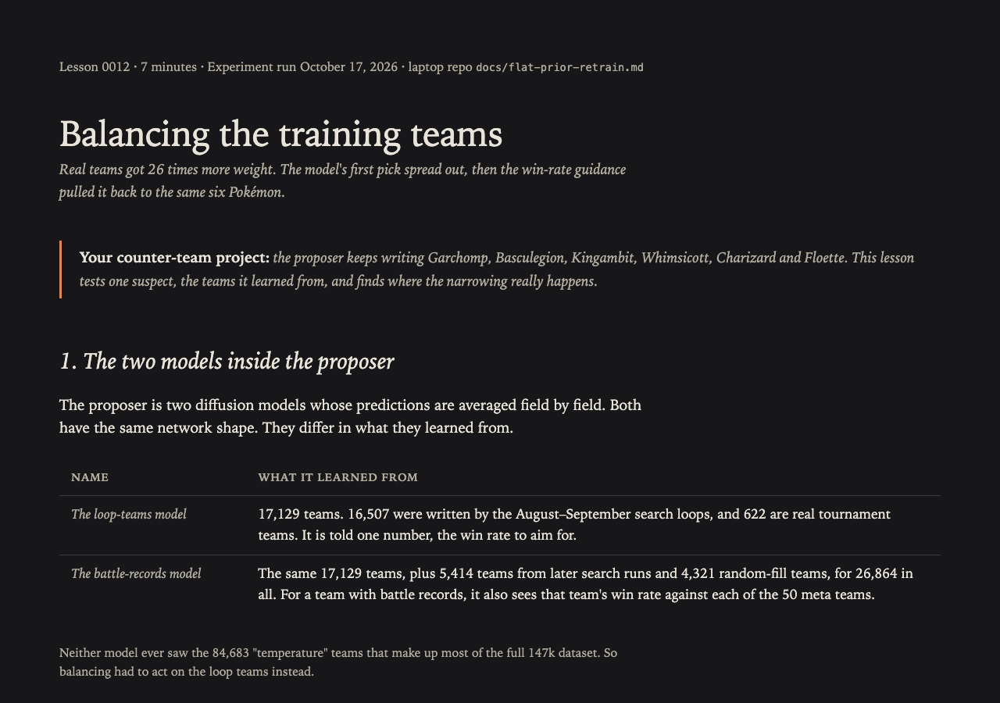
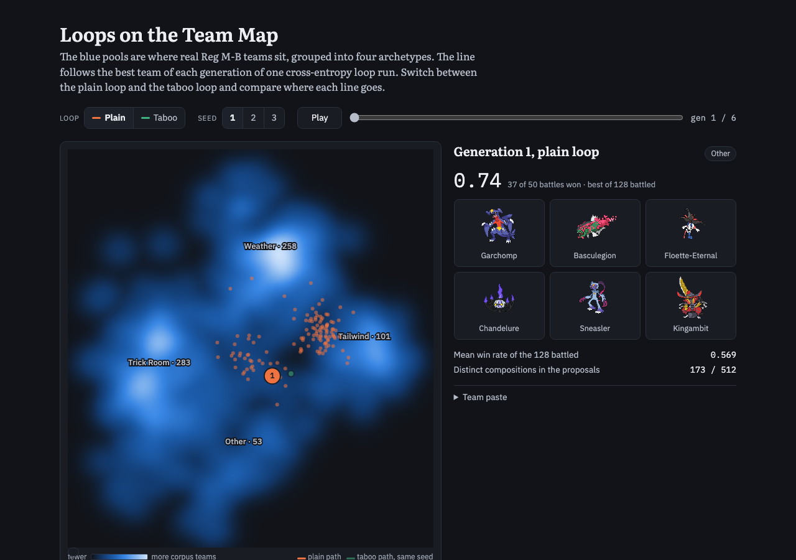

The one deletion was Claude undoing its own mistake. I asked it to swap in "the nice version" of my random-noise figure; it ported a scroll prototype, and I pointed it to the one I meant, the 2026-09-25 slot-reel page I consider the best figure I have. Claude removed the wrong port from the branch and the vault, put the slot-reel page in the [noise-to-archetypes folder](visuals/noise-to-archetypes/README.md), and it went live through [PR #28](https://github.com/Rami-Ismael/Battle-Factory-of-Porygon-Pi/pull/28).

I kept pushing on Diffusion-BBO. I believed each round battles every w; Claude checked the paper and found it scores all five asks but generates and battles at only the chosen one. I queued a variant that battles at all five anyway, labelled as not the paper's rule; it scored 0.463, and the full paper rule scored 0.452, both below the 0.504 baseline. Win rate here is wins against the top-50 meta teams, with the behaviour-cloning policy on both sides. When I asked what caused the drop, Claude built four fixes, pre-registered in the [Diffusion-BBO write-up](/Users/ramiismael/Documents/code/vgc-team-generator-pilot/docs/dbbo-faithful.md): more training data, a reachable ask, ridge selection, and all three. Their finalists scored 0.561, 0.557, 0.539 and 0.581, against 0.559 for the plain loop pooled over three seeds. Claude reported the data fix and the combined fix beating the plain loop, but by only 0.002 and 0.022, from one seed each, and those fix scores are not in the write-up yet. I read them as level with the plain loop.

I also asked whether the model's first guess is uniform over Pokémon, since a skewed start could explain the lost diversity. It is not: Garchomp fills 10.1% of species slots in the training set against 5.7% in real teams, because 58% of the rows come from one earlier loop family. Claude retrained with the families balanced, and it [failed](/Users/ramiismael/Documents/code/vgc-team-generator-pilot/docs/flat-prior-retrain.md): line-ups did not widen at ask 0.5, win rate fell by 0.047 [0.032, 0.063], and confirmed winners dropped from 10 to 3. The skew is not what narrows the first generation; the win-rate guidance is. Claude explained it in a [lesson](</Users/ramiismael/Documents/yakumsi-vault/Personal Project/Using Advance method search in the whole search of possible vgc pokemon format to find the right counter to a pokemon team/.claude/worktrees/modest-chandrasekhar-035afa/Teaching/lessons/0012-balancing-the-training-teams.html>) that I still have to copy into the vault. I also worked through CADS in a question-and-answer drill.

*The [balancing lesson](</Users/ramiismael/Documents/yakumsi-vault/Personal Project/Using Advance method search in the whole search of possible vgc pokemon format to find the right counter to a pokemon team/.claude/worktrees/modest-chandrasekhar-035afa/Teaching/lessons/0012-balancing-the-training-teams.html>) names the two models by what they learned from.*

I wanted to know whether the diffusion model makes a better mutation step than hand-written edits. Claude's literature check found one paper that tests diffusion mutation against random mutation at a matched budget, and its gain came from legality, which my hand-written edits already guarantee. Claude then ran the test inside deep-surrogate MAP-Elites, as [pre-registered](/Users/ramiismael/Documents/code/vgc-team-generator-pilot/docs/diffusion-mutation-arm.md): the diffusion step beat the hand-written edits by +0.105 against the top 50, but only +0.009 against held-out ranks 51–100. The gain does not carry over to unseen teams, and its final numbers appear only in Claude's end-of-run summary, not in a write-up.

Two older questions got answers. A Claude session traced the 40 fine-tuning epochs in my loop to a choice Claude made on 2026-09-01 that no message of mine asked for. That night its battle-free check reported no overfitting, but on 18 October the same session corrected itself after I pointed at the diverging loss curves: held-out loss is lowest at epoch 35 and 0.002 to 0.005 higher by epoch 40, so 40 [slightly overfits](https://claude.ai/artifact/2BC1sdTQCbnSsiVVqZXzHq) (private), though it still beats 10 and 20. A battle test at 1, 2 and 5 epochs is queued.

The slot-order fix moved forward, slowly. That morning I copied the shuffle code into staging, the folder my experiments run from. Staging still defaulted to the old listed order, because Claude had set it to switch only after the running Diffusion-BBO jobs finished, so that no experiment mixed shuffled and listed battles. Claude set a watcher to make the switch, but the watcher stopped when its session ended, and by evening a new run was using staging. In the evening I asked Claude to commit the work and whether my past experiments were free of the position bias. It committed the fix as `cca1d88` on a branch, `slot-order-shuffle`, with a [write-up](/Users/ramiismael/Documents/code/vgc-team-generator-pilot/docs/slot-order.md), and its answer was no. Every earlier experiment battled teams in listed order, so each score carries an order effect of about 0.018 win rate. That is too small to overturn large results, but enough to blur close comparisons. Three older scoring scripts still read teams in listed order. Shuffling also does not remove the policy's preference for slots 2 to 4. It gives every Pokémon the same mix of slots, so a team's score stops depending on how its file is written. Removing the preference itself would mean retraining the battle policy. The branch merged into `main` on 18 October, and staging still runs listed order.

My [Reading List](<../Papers/Reading List.md>) grew a lot. Claude added five papers on diffusion as a mutation operator, a Year column, a Citations column from Semantic Scholar (270 of 293 rows), and a Looped transformers section. It graded 108 ungraded papers from their abstracts; an adversarial second read of the six new HIGH grades against the full papers left only DSA-ME at HIGH. It also graded all 100 papers from the workshop where one paper I'm reading appeared: none reached MED, and 63 abstracts were blocked by OpenReview's bot check, so those were graded by title. At my request it added two of them as LOW rows.

I asked for a figure like a heat map I saw in a tweet. Claude built [Loops on the Team Map](visuals/team-map-path/team-map-path.html): real Regulation M-B teams as four archetype pools, the best team of each loop generation traced across them, and a plain-versus-taboo toggle. I then had it add a grid of weather, Tailwind and Trick Room teams by generation.

*[Loops on the Team Map](visuals/team-map-path/team-map-path.html): generation 1 of the plain loop, its best team at 0.74 over 50 battles.*

Claude mapped my [blog outline](../Blog.md) again and created eight more frontmatter-only section notes, such as "The battle bot benches whoever is listed first". I later had Claude move all eight to the Trash, because I had not approved creating them. We talked through how legality and smoothness connect: legality decides what counts as a small edit, and smoothness measures win rate across those edits. A grill on a Datasets section for my README found that the ~147k training set is a pool built from my other sources, not a separate source. Mask Lab's rebuild merged as [PR #26](https://github.com/Rami-Ismael/Battle-Factory-of-Porygon-Pi/pull/26).

On tooling, I had Claude add a hook that makes every task-shaped reply state whether a subagent fits; it later moved the rules into my personal Claude instructions, and the hook now only points to them. Claude built a [contact-sheet skill](/Users/ramiismael/.claude/skills/contact-sheet/SKILL.md) for Claude Code and Codex, so visual reviews tile screenshots into one image instead of many. It also checked [Ponytail](https://github.com/DietrichGebert/ponytail) against advice to write less code; nothing was installed. Codex did no work of its own this day; its records hold only imported copies of Claude sessions. In this session, Claude wrote my [October 16 blog](<Blog for 2026-10-16.md>), and I had it raise the blog limit to 16,384 characters and add frustration rules.

**Frustrations with Claude Code.** I collect these so later sessions do not repeat them. Codex did no work this day, so every row is Claude Code.

| Frustration | Source | Fix | Status |
|---|---|---|---|
| **Repeated instruction.** I had asked to stop calling the models "F1" and "G2", yet the labels came back, and I later asked what a "family trained member" meant. | Claude Code, "Flatten the species prior" (2e3c8050), 11:02 and 17:29. "What is running now" (75c869c9) still wrote F1 and G2 at 11:03 and 12:11. | One vocabulary note, `CONTEXT.md`, in the vault for every session, built with `mattpocock-skills:domain-modeling`. | Naming rule saved to memory that day. The vault note is a proposal. |
| **Not doing exactly what I asked.** I asked for "the nice version" of my noise figure without naming the page, and Claude guessed instead of asking. Cost: a port built, then removed. | Claude Code, "Pokemon noise generator upgrade" (2a606340), 10:38 to 11:03. | I name the exact file. Claude shows the candidates with the `contact-sheet` skill and waits for a yes. | The skill exists (built that day). The wait-for-yes step is a proposal. |
| **Stalls I found by asking.** I asked what was running eleven times. The answers showed the final scoring step had crashed in all five Diffusion-BBO runs with no battle server up, the Mac had slept half an hour on battery, and idle servers were left twice. Cost: the scoring step had to be rerun. | Claude Code, "Diffusion-BBO paper analysis" (9bce7f98), 06:18 to 09:43, and "What is running now" (75c869c9), 11:02 to 22:25. | A queue status page, refreshed by the queue itself, that shows each job, failed steps, live battle servers and the battery. The queue starts its own servers. | Proposal. |
| **Collision between sessions.** One session's stray copy overwrote the file that held another session's new ask rule. Claude rebuilt it within two minutes, before any run used it. | Claude Code, "Inverse-model loop: train on all labels, ask from delivered" (29021f6a), 07:45. | An ownership table that lists which session owns each script. Other sessions send that session requests. | Proposal. |
| **Hook blocks.** Worktree sessions could not write my vault. A Reading List edit needed my one-time approval, a lesson stayed outside the vault, and the skills report was not updated. | Claude Code, "Diffusion models as mutation operators" (dca3daf2), 09:59; "Flatten the species prior" (2e3c8050), 17:36; "Contact-sheet screenshot reviews for agents" (946f564d), 22:13. | Start vault-editing sessions in the main checkout. | Setup choice, not yet made. |
| **Decision made without me.** The 40 fine-tuning epochs came from Claude, unasked, and I only found out by tracing them. | Claude Code session 19a70c6f, 2026-09-01. Traced in "Trace the 40-epoch fine-tune and test overfitting" (4b3ac919), 22:57 to 23:38. | Every result page lists the settings Claude chose on its own. | Proposal. |
| **Not reasoning carefully enough.** Claude said 40 epochs did not overfit while its own curves diverged from about epoch 15 and held-out loss bottomed at 35. It said a plain yes only after I pointed at the curves. Cost: a wrong verdict in memory overnight and in the first version of this post. | Claude Code, "Trace the 40-epoch fine-tune and test overfitting" (4b3ac919), 23:38. Corrected 18 October, 13:31 to 13:34. | Judge overfitting by the gap between training and held-out loss and by the held-out minimum, verdict first. Show both curves on one chart with the minimum marked. | Rule saved to memory on 18 October. The chart is a proposal. |
| **My side: repeated request.** I typed the same long grill request four times. | Claude Code, "Metamon datasets documentation" (6a764336), 10:40; "Diffusion models as mutation operators" (dca3daf2), 17:32; "Subagent prompt design guidance" (79e80a76), 18:43 and 18:53. | One saved skill that runs `grilling` with `pskill:recall`, the `writing-for-agents` rules and a subagent claim check, built from my [How to grill me](<../How to grill me.md>) note. | Proposal. |
| **My side: wrong claim.** I claimed a new best team at 0.706. No fresh score matched, and the real best finalist was 0.734. | Claude Code, "Pokémon VGC team-search daily blog" (dcaa89d0), 07:51. | A subagent checks a result before I state it. | Done that day. |
| **Claude's slips in this session.** Its edit to my blog prompt merged two paragraphs, and its Haiku checkers ran out of context three times. | Claude Code, "Pokémon VGC team-search daily blog" (dcaa89d0), about 07:55 to 08:10. | Diff every prompt edit against a backup before saving. Give each checker one small evidence file. | Both done that day. |
