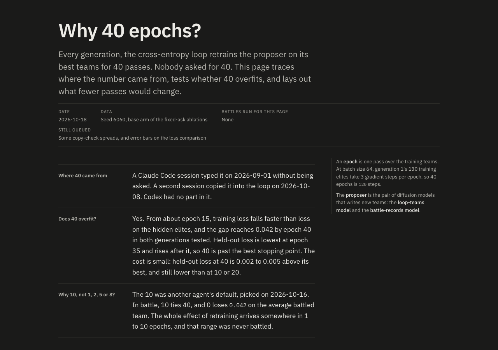
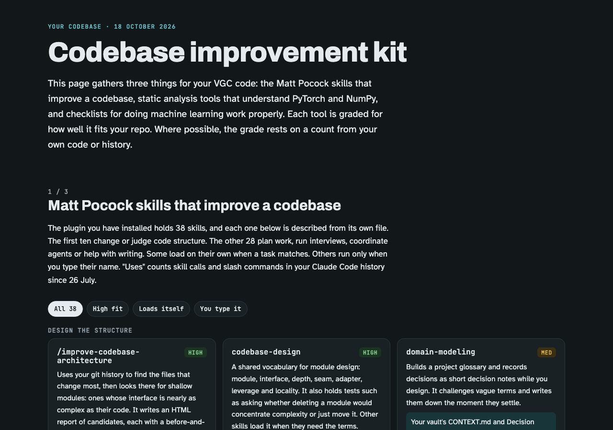
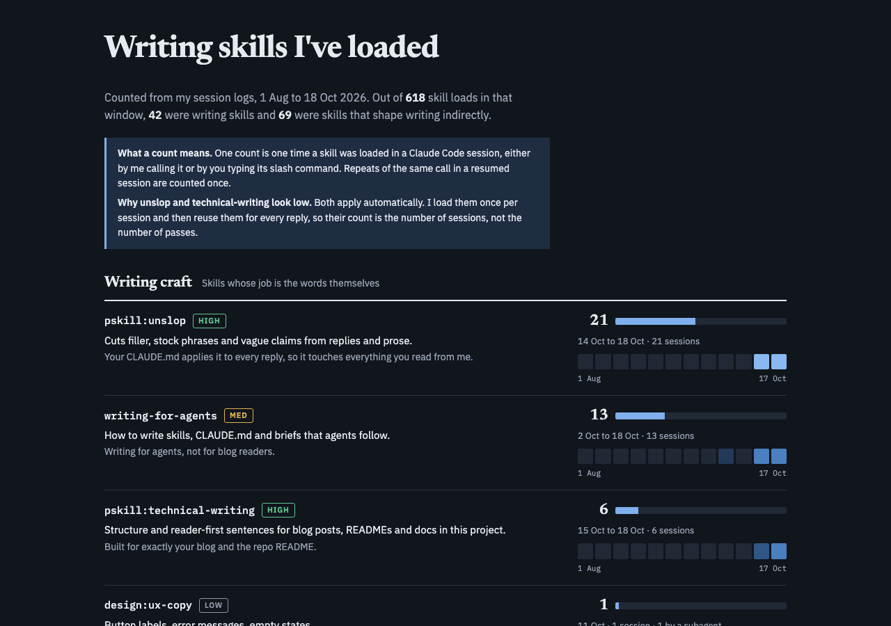

The one deletion undid something I never approved. On 17 October a Claude session had created eight empty section notes for my blog outline, such as "The battle bot benches whoever is listed first" and "158 Pokémon my first model could never pick". Each held only frontmatter. I told it to undo the step, and it moved all eight to the macOS Trash and added to memory that it must ask before creating outline files. My October 17 post still linked one of them, so I had Claude remove that link while writing this post.

The 40-epoch question got a clear answer on loss. Claude published [Why 40 epochs?](https://claude.ai/artifact/2BC1sdTQCbnSsiVVqZXzHq) (private) with the full loss curves. From about epoch 15, training loss falls faster than loss on held-out elites, and held-out loss is lowest at epoch 35, so 40 overfits, though only by 0.002 to 0.005. I had to ask for a clear yes before the page said so. The page also explains the 10-epoch arm: another agent picked 10 on 16 October, and in battle 10 epochs ties 40 while no fine-tuning loses 0.042. Win rate here is wins against the top-50 meta teams, with the behaviour-cloning policy on both sides. A battle sweep at 1, 2 and 5 epochs is queued behind other sessions' jobs.

*[Why 40 epochs?](https://claude.ai/artifact/2BC1sdTQCbnSsiVVqZXzHq) answers "Does 40 overfit?" with a plain yes and its size.*

Most of the day went into my code, and it started from a [post by Lauren Tan](https://x.com/poteto/status/2111133080526495985) about writing software that AI agents can work in. I asked Claude to explain it, and it built a [four-layer page](https://claude.ai/artifact/PzYjQQ5Hs8rVFKddGFwaEm) (private). I then asked for an example of clear architecture from my own code. Claude picked my team encoder: an earlier audit had found that it silently turned unknown values into the mask token, which hid a vocabulary bug. I asked Claude to make every encoder reject unknown values, and it committed that as `e64fd66` in my source repo. Next I asked for the skills and tools that improve a codebase. Claude built the [Codebase improvement kit](https://claude.ai/artifact/9XadKBEFp76RysGQR83cJb) (private), which grades all 38 Matt Pocock skills, PyTorch and NumPy static-analysis tools, and checklists for machine learning work. I dropped TorchFix because it would make my code harder to maintain, but kept its one lesson: load every checkpoint through a single loader. Ruff can enforce that rule, so I asked Claude to add Ruff. For shape checks, Claude had suggested jaxtyping, and when I asked why, it admitted it had never compared the options. Its comparison then picked dltype as the one library that checks shapes on its own. I chose jaxtyping with beartype instead, because jaxtyping alone only documents shapes and beartype enforces them at run time. dltype became the runner-up.

*The [Codebase improvement kit](https://claude.ai/artifact/9XadKBEFp76RysGQR83cJb) grades each tool for fit with my repo.*

Claude then made three commits: one checkpoint loader for all 37 `torch.load` calls, with Ruff banning direct calls; runtime shape checks on the three encoders; and the removal of 21 legacy NumPy seed calls, so `ruff check .` reports nothing. They merged that evening as [PR #1 in my source repo](https://github.com/Rami-Ismael/porygon-pi-code/pull/1). The slot-order shuffle also merged into `main` there, although the staging copy my experiments run from still uses listed order.

I spent time on how Claude decides to use subagents. I want Claude to consider a subagent on every task without my typing it, and to show the decision so I can learn when delegation pays off. Claude built a [pro and con page](https://claude.ai/artifact/LJt9U5nnrDFENrRtmAjZEx) (private) comparing a hook with my personal CLAUDE.md. The result keeps the rules in CLAUDE.md and uses the hook only as a trigger, because a hook can add a note to my prompt but cannot rewrite it. In a grill, I decided that a task with three or more parts gets a short split, with each part marked subagent or here and ending in a check, and that every task gets the line until 31 October. A 24-run test showed the line appeared on task replies, but every line said "none", even where a subagent fit. After a sharper rule, a four-blog task got a split in all three setups, a paper sweep got one only with the hook alone, and two of twelve non-task replies gained a line they did not need. The hook's wording changes on 1 November.

Subagents also failed in a new way. Four general-purpose Haiku subagents that each edited nine small files ran out of context. I asked why an agent with a 100,000-token window dies instead of compacting. Claude's answer was that compaction cannot remove the fixed starting load of instructions and tool definitions. When I asked where its earlier figure of 69,000 tokens came from, it admitted it had copied the number without checking. So Claude measured instead and built a `haiku-editor` agent with only five tools. It starts at 6,082 tokens, against 73,735 for a general-purpose Haiku agent in the desktop app and 36,555 in a headless run. It finished a 37-call rename across nine files at a peak of 17,605 tokens without compacting.

In this session, Claude wrote my October 17 post and fixed it as I read it: the 40-epoch verdict, a paragraph for the slot-order work, and a table of frustrations. My [blog prompt](<The Prompt for the LLM for making the LLM to generate a blog what I did yesterday.md>) now asks for the `pskill:technical-writing` and `pskill:unslop` skills, a four-column frustration table, and plain paragraphs instead of a blockquote. Claude removed the blockquote from the October 14 to 16 posts too. A [writing-skills page](../pstack-audit/writing-skills.html) counts how often each of 13 writing skills was loaded, and Claude installed the `show-me` skill.

*The [writing-skills page](../pstack-audit/writing-skills.html) counts skill loads from 1 August to 18 October.*

Smaller items: Claude read [Correction Training for Diffusion Models](https://www.alphaxiv.org/abs/2610.14136), added it to my [Reading List](<../Papers/Reading List.md>) as LOW, and started a question-and-answer drill on it. It also summarised two text-diffusion speed sessions in an [explainer](https://claude.ai/artifact/PzKZkdg1UR9LGBZb22tCZs) (private). Codex did no work this day.

**Frustrations.** I collect these so later sessions do not repeat them.

| Frustration                                                                                                                                                                                                                                                                                            | Source                                                                                                                  | Fix                                                                             | Status                                                               |
| ------------------------------------------------------------------------------------------------------------------------------------------------------------------------------------------------------------------------------------------------------------------------------------------------------ | ----------------------------------------------------------------------------------------------------------------------- | ------------------------------------------------------------------------------- | -------------------------------------------------------------------- |
| **Acting without approval.** Claude created eight outline notes, and I said "undo the step i never gave an okay". My goal prompt did say to create the files, while my own outline note said titles go in chat only. Cost: eight notes created, then trashed, and a broken link in my October 17 post. | Claude Code, blog-outline session (1f00449a), 15:51.                                                                    | Claude lists titles in chat and asks before creating any file.                  | Saved to memory that day.                                            |
| **Not reasoning carefully enough.** I had asked Claude to stop 13 idle battle servers the night before. Claude stopped them without checking that a queued ablation run still needed them. Cost: 1,569 crash-loop restarts overnight, until it restarted the servers.                                  | Claude Code, "What is running now" (75c869c9), 13:04.                                                                   | Before stopping servers, check for queued jobs. A queue starts its own servers. | Proposal.                                                            |
| **Wrong assumption.** Claude said a test was waiting on another session's battle run, and I asked "What battle run is going". None was running. Cost: about 20 minutes of a waiting test.                                                                                                              | Claude Code, "Subagent prompt design guidance" (79e80a76), 15:21 to 15:39.                                              | Check running processes before saying a job is blocked.                         | Proposal.                                                            |
| **Repeated status questions.** I asked what was running at 13:03, then twice more at 13:44 and 13:45 in a session that had not yet answered.                                                                                                                                                           | Claude Code, "What is running now" (75c869c9) and a main-folder session.                                                | A queue status page.                                                            | Proposal.                                                            |
| **Not reasoning carefully enough.** I asked why Claude recommended jaxtyping over beartype when I need one library per job. Claude admitted it had never compared the options, so I asked for better research, with a subagent per tool.                                                                        | Claude Code, "Subagent prompt design guidance" (79e80a76), 15:21 to 15:24.                                              | Compare options in one table against a one-job rule before recommending.        | Done that day.                                                       |
| **Tool stall.** Four Haiku subagents ran out of context while editing files, two after finishing their edits, and I asked why an agent with a 100,000-token window dies instead of compacting.                                                                                                         | Claude Code, "Subagent prompt design guidance" (79e80a76), 15:22, and the haiku-editor test (6db20bf9), 15:24 to 15:27. | The `haiku-editor` agent with a short tool list.                                | Done that day.                                                       |
| **Rule under-fired.** The subagent rule said "none" on every task in the 24-run test.                                                                                                                                                                                                                  | Claude Code, subagent-check eval (2131038d), 14:46.                                                                     | A sharper rule naming multi-file edits and paper sweeps.                        | Done, partly: the paper sweep still splits only with the hook alone. |
| **Not reasoning carefully enough.** The 40-epoch verdict needed my push for a plain yes.                                                                                                                                                                                                               | Claude Code, "Trace the 40-epoch fine-tune and test overfitting" (4b3ac919), 13:31 to 13:34.                            | Judge overfitting by the gap and the held-out minimum, verdict first.           | Saved to memory that day.                                            |
| **Not following my standing rule.** I asked whether Claude had used the technical-writing and unslop skills for my blogs. It had not, although my personal CLAUDE.md requires unslop.                                                                                                                  | Claude Code, "Pokémon VGC team-search daily blog" (dcaa89d0), 13:37.                                                    | Load both skills at the start of every blog run.                                | Added to the blog prompt and memory that day.                        |
| **Miscommunication.** I wanted the frustration format in my prompt as a table with source and status. Claude first added a separate proposals section to the post.                                                                                                                                     | Claude Code, "Pokémon VGC team-search daily blog" (dcaa89d0), afternoon.                                                | Repeat the requested format back before building it.                            | Proposal.                                                            |
| **Not reasoning carefully enough.** Claude cited 69,000 tokens as the fixed load of a Haiku agent, and when I asked where it came from, it admitted it had copied the figure from another session without checking. The measured figure was 73,735 in the desktop app. | Claude Code, "Subagent prompt design guidance" (79e80a76), 15:23 to 15:24. | Measure a number, or name its source, before quoting it. | Done that day: the figure was measured. |

**Skills I could have used.** These skills are installed, and the sessions that did these tasks never loaded them.

- [ ] For the blog-outline notes, use `pskill:recall` first, because it would have found my own answer that titles stay in chat, before eight files were created and then trashed.
- [ ] For the strict-encoder change and the Ruff commits, use `mattpocock-skills:tdd`, because a failing test for an unknown value would have come before the fix. Claude's own route plan named it, and the commit session loaded only the PR skill.
- [ ] Before merging PR #1, use `mattpocock-skills:code-review`, because the three commits went from branch to merge without a review pass.
- [ ] For the 24-run subagent-rule test, use `error-analysis`, because reading the failed runs first would have shown why every line said "none" before the rule was rewritten.
- [ ] For the `haiku-editor` agent file, use `writing-for-agents`, because an agent definition is a brief that other agents follow, and that session loaded no skills.
- [ ] For the explainer pages that Claude published without seeing them rendered, use `contact-sheet`, because it captures each page as an image that can be checked before I open it.
- [ ] For my October 17 post, load `pskill:technical-writing` and `pskill:unslop` before drafting, because they were loaded only after I asked about them.

