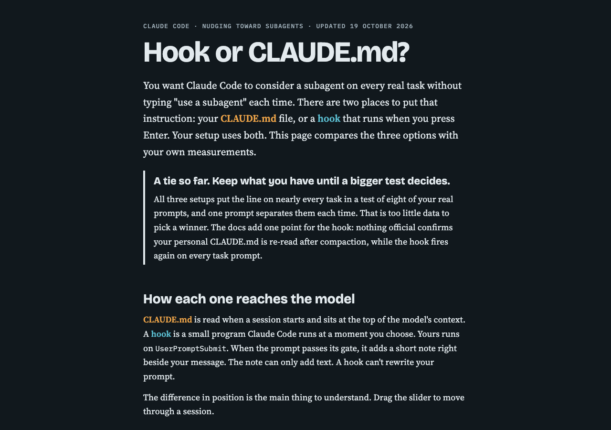
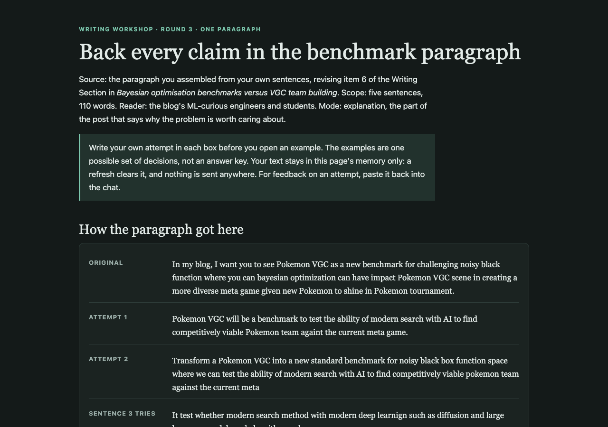

Most of the day went into cleaning up my code repo, `porygon-pi-code`. I ran the `improve-codebase-architecture` skill on `llm_baseline.py`, the script that runs my language-model baseline. Its report found one shallow module doing five jobs, imported by 30 scripts, and offered four candidates. I chose to split it into modules by what changes together, and to drop the old slow battle engine and keep only the fast runner. A side session split the file into six `src/` modules over five commits, leaving `llm_baseline.py` at 43 lines with the tests matching the baseline.

Before the pull request, I ran `/code-review` and `/pr`. The review found 18 judgement calls on the Standards side, mostly in code that moved unchanged, and 4 Spec findings. The worst Spec finding was that the old `pair_shard` engine survives because `matchup_db` still uses it. The test suite now runs in 4 seconds instead of 925. When I asked Claude to push, it stopped. The branch sat on my held-out work, a local commit of 156 files never pushed, including a vocabulary file of 173,000 lines, and pushing it would have published all of that. So the work went up as two stacked pull requests. [PR #2](https://github.com/Rami-Ismael/porygon-pi-code/pull/2) carried my experiment work and [PR #3](https://github.com/Rami-Ismael/porygon-pi-code/pull/3) carried the split. Reviewing PR #2 found that setting `ALLOW_CONTAMINATED_CHECKPOINTS=0` still turned the guard on, so Claude fixed it to accept only `1` and added a test that fails without the fix. Both merged that morning. [PR #4](https://github.com/Rami-Ismael/porygon-pi-code/pull/4) then routed 22 more `torch.load` calls through the single checkpoint loader, and [PR #5](https://github.com/Rami-Ismael/porygon-pi-code/pull/5) fixed a test-isolation bug. Ruff now reports only six NumPy findings, and their fix waits on its own branch.

I worked on the subagent rules again. Claude rebuilt the [Hook or CLAUDE.md page](https://claude.ai/artifact/LJt9U5nnrDFENrRtmAjZEx) (private) with my answers. It now calls the three setups a tie on the measured results and names the larger test that would decide it. I asked for a paper-reading shape, one subagent on a paper's references and one on the papers that cite it, and Claude added it to my personal CLAUDE.md. I also asked for the measured Haiku limits per agent type. An Explore agent starts at about 40,000 tokens, so it has room for a read-only sweep, while a general-purpose agent starts near 74,000.

*The rebuilt [Hook or CLAUDE.md page](https://claude.ai/artifact/LJt9U5nnrDFENrRtmAjZEx) calls the setups a tie until a bigger test decides.*

For the main blog post, I asked Claude to lead with the biggest result. It drafted a hook from the results files, and a second agent checked every number. The best team the search built won 0.734 ± 0.032 against the top-50 meta teams, level with the best real team at 0.691 ± 0.020. Win rate here is wins against the top-50 meta teams, with the behaviour-cloning policy on both sides. Three search-built teams beat 0.691 on the point estimate, but none by more than noise, and all three share the same five Pokémon.

The rest of that session was writing practice. I used the `writing-workshop` skill on my benchmark paragraph and worked through two full attempts plus several tries at single sentences. My version argues that most academic benchmarks are static, while Pokémon VGC changes each regulation, so it tests search in a world that keeps moving. I told Claude to stop flagging "Pokemon" without the accent, because I type on an English keyboard. Claude built two more workshops, for my team-preview section and my battle-complexity section. All three pages sit in a worktree, not the vault, because a guard blocks writes from that session.

*The [benchmark-paragraph workshop](<../.claude/worktrees/blog-post-structure-715261/artifacts/writing-workshop-bo-benchmark-20261019.html>) shows how my paragraph changed across attempts.*

In this session, Claude finished my October 18 post, including a "Skills I could have used" section. My [blog prompt](<The Prompt for the LLM for making the LLM to generate a blog what I did yesterday.md>) now builds that section in four checked steps, with Haiku subagents proposing skills. I asked what the `tdd` and `code-review` skills do, and Claude advised running a review before `/pr`. Claude then rewrote three parts of the October 18 post with the reasons behind Ruff, the new Haiku agent and the subagent rule, from chains traced by three Haiku agents. In a side session, I set up the Vale prose linter on my blog with Google's style rules. A run on five posts found 570 issues, mostly noise. An accept list for Pokémon and tool names, two Google rules turned off, and four project rules for "threshold", F1 and G2, em dashes and blockquotes cut that to 196, and it caught one real typo, "Boltzman".

Codex did no work this day.

**Frustrations.** I collect these so later sessions do not repeat them.

| Frustration | Source | Fix | Status |
|---|---|---|---|
| **Miscommunication, my side.** The parent session had told the split session to wait for my commit, then I told the split session directly "Can you start the refactor know". It split a snapshot, not my committed work. Cost: a rebase, and a snapshot commit dropped. | Claude Code, split session (7f4359ae), 01:40, and "Subagent prompt design guidance" (79e80a76), 02:14. | Send instructions for a side session through one session only. | Proposal. |
| **Not doing exactly what I asked.** I asked for `/writing-for-agents` in my grill request, and the skill was not loaded. | Claude Code, "Subagent prompt design guidance" (79e80a76), 01:00. | When my message names a skill, load it or say why not. | Done 20 October: a hook blocks edits to agent files until the skill is called. |
| **Skill only I could start.** I asked for `/show-me` after the split to check how clear the code is. Its settings let only me start it, so Claude told me four times to type it. I never did, and the check never ran. | Claude Code, "Subagent prompt design guidance" (79e80a76), 01:35 to 06:55. | Let Claude start `show-me` too. | Done 20 October. |
| **Wrong assumption.** Claude counted "Pokemon" without the accent as a mistake. I wrote "I using english keyboard I have no ideas how to add hypen". | Claude Code, "Blog post structure and outline" (1f00449a), 08:51. | Never flag the missing accent. | Saved to memory that day. |
| **Not verified.** Claude rebuilt the Hook or CLAUDE.md page at the same link without seeing it rendered. | Claude Code, "Subagent prompt design guidance" (79e80a76), 01:07. | Screenshot every page with the `contact-sheet` skill before publishing. | Proposal. |
| **Hook block.** Three writing workshops stayed in a worktree because the guard blocks vault writes. | Claude Code, "Blog post structure and outline" (1f00449a), 08:29 to 11:59. | Start vault-writing sessions in the main checkout. | Proposal, still not made. |
| **Repeated request.** I sent the same `improve-codebase-architecture` request three times between 01:19 and 01:22. The reason is unclear from the record. | Claude Code, "Subagent prompt design guidance" (79e80a76), 01:19 to 01:22. | Claude confirms in one line when a skill starts. | Proposal. |
| **Repeated request.** I typed my long grill request again, as on 17 and 18 October. | Claude Code, "Subagent prompt design guidance" (79e80a76), 01:00. | One saved grill skill. | Proposal since 17 October. |
| **Push stalled, a good catch.** My push request stopped because the branch would have published 156 files of held-out work. Cost: the work split into two stacked pull requests. | Claude Code, "Subagent prompt design guidance" (79e80a76), 03:02. | Check what a branch carries before asking to push. | Done that day. |
| **Tool noise.** Vale reported 570 issues on five posts, mostly rules that clash with my blog's conventions. | Claude Code, "What is a prose linter" (57a8e687), 00:53. | An accept list and project rules. | Done that day: 196 left. |

**Skills I could have used.** Each session loaded few skills. Four Haiku Explore agents proposed missing ones from each session's tasks and the installed list, and I kept the clear fits.

- [ ] For the hook-or-CLAUDE.md grill, call the `grilling` skill. I asked to be grilled, but the session wrote its own three questions instead of calling the skill.
- [x] For the edits to my personal CLAUDE.md, use `writing-for-agents`, because I asked for it and the subagent rules are text that agents must follow.
- [ ] After the `llm_baseline.py` split, type `/show-me` or ask Claude to use it, to check how clear the new modules are. Until 20 October only I could start it.
- [ ] I need to determine what is mine project glossary
	- [ ] Add 'results store' to the code repo's `GLOSSARY.md` once it exists.
- [ ] For the split itself, use `codebase-design`, because the split session did not load the module and seam vocabulary that its parent session had.
- [ ] For my game-theory paragraph, where I did not know how to start, use `writing-beats`, because it orders a section into beats and defines each term before it is used.
- [ ] For explaining why we adopted Ruff, the new Haiku agent and the subagent rule, use `pskill:why`, because it traces a design choice to its cause.
