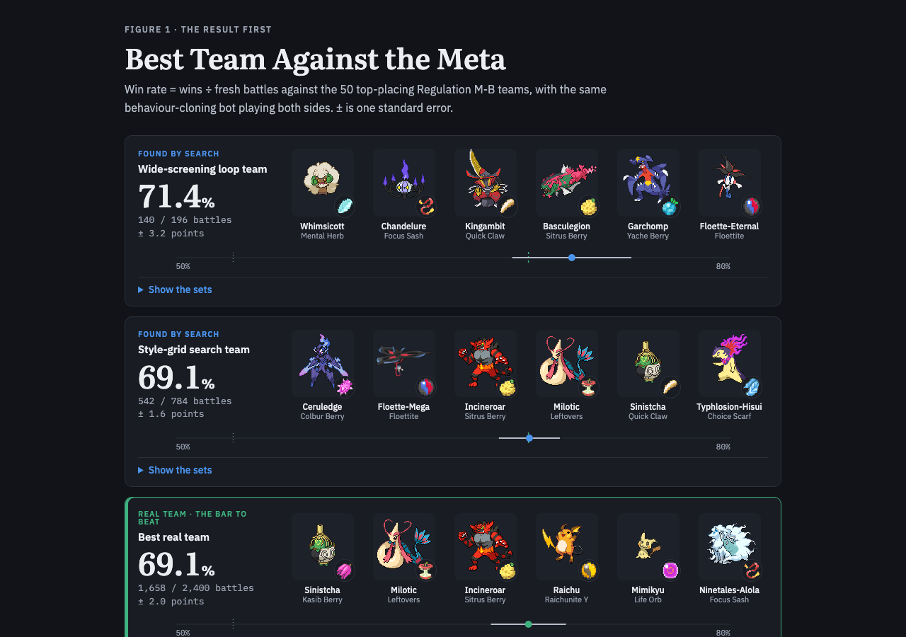
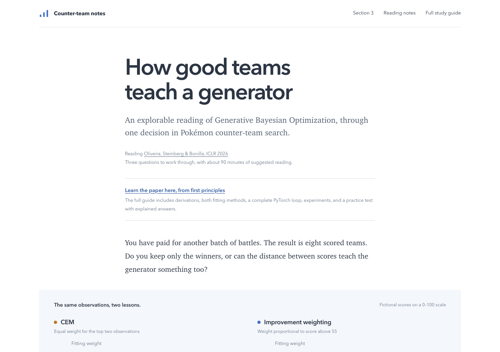
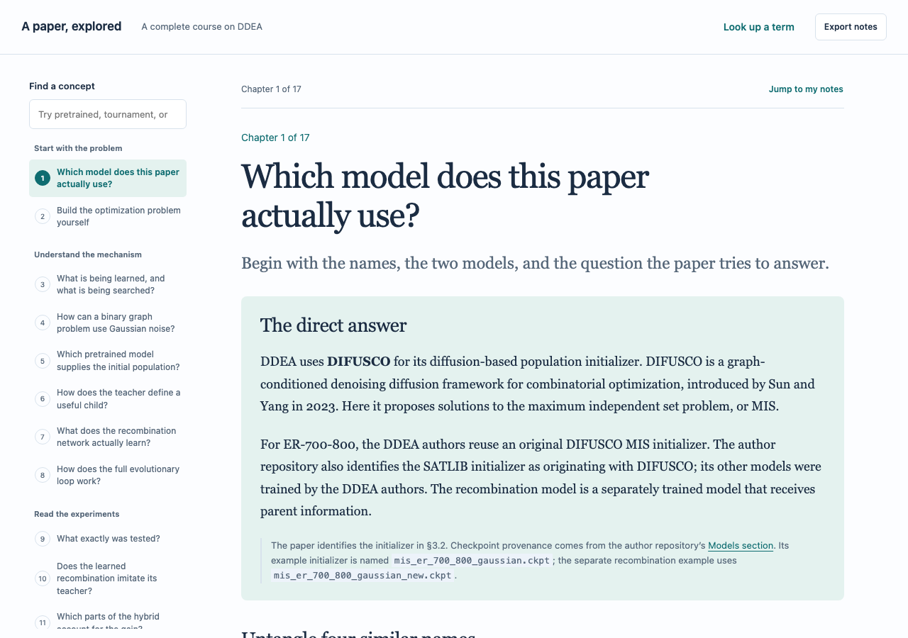

The biggest thing I started was an experiment, and it was still running at midnight. In the evening I asked Codex to grill me on using the diffusion model as a mutation operator, compared with random or hand-written edits. Codex first recovered the earlier pilot: its best teams won 62.9% with diffusion mutation, 56.3% with uniform legal refill and 52.4% with hand-written edits, against the opponents used during search, and the gap on held-out ranks 51–100 was inconclusive. I had to ask it to "grill me properly", because it opened with a planning menu instead of questions. The idea I settled on was local search from a good parent team: "keep some random mutation for exploration and use diffusion for most of the local search, then increase random mutation if it gets stuck."

Codex turned that into a [research instruction](<../Diffusion-guided local search — research instruction.md>) and then a paste-ready [Codex goal](<../Codex goal — diffusion-guided local search.md>). I sent three corrections: paste the goal in a code block instead of pointing me to a file, drop the grilling step, and include implementing and running the experiments, not only a plan. At 19:07 I asked it to start the goal with subagents. Codex wrote a [preregistration](<../experiments/diffusion-local-search-20261020-a7f42c9e/preregistration.md>) before the first battle. It covers eight arms: hand-written edits, uniform refill, diffusion, a fixed mixture, the adaptive mixture, and three controls that separate ordinary score conditioning, unconditional sampling and the old ask of 0.5. The main diffusion arms ask for about 0.667, the 95th percentile of the 313 eligible starting labels. The first smoke run failed before any battle because relative paths broke inside a subprocess. After the fix, the first generation finished 3,072 of 3,072 battles at 19:48. The Mac slept during one stage around 20:30, even with an idle-sleep guard running, and an [audit](<../experiments/diffusion-local-search-20261020-a7f42c9e/sleep-battle-audit.md>) recommended keeping that stage and disclosing the interruption. By 23:56 the [run log](<../experiments/diffusion-local-search-20261020-a7f42c9e/RUN_STATE.md>) recorded 282,624 battles across 92 generations with no errors. Those battles were all search. The fresh evaluations that decide the win rates had not started by midnight, so the results belong to the next post.

Claude Code was only part of the morning. At 11:11 it hit its weekly limit, which resets at 7 a.m., and the rest of my day ran in Codex. The limit stopped one session at its first step: a rewrite of my [Bayesian optimisation benchmark comparison note](<../Teaching/reference/bo-benchmark-derived-vgc-research-comparison.md>) as a new Version 4, so that note is unchanged.

Before the limit, the main Claude result was a new Figure 1 for my blog post. I asked Claude to find the best-performing team in the Elites on a Map page. It found a team that won 0.69 of 784 fresh battles, the same team my Best Team page lists at 0.691. I said the old best-team figure was bad and that a website-style design would work better than a chart. Claude rebuilt it, and with the `prototype` skill I compared three versions inside my real article frame. I kept version B, one team per row: six sprites with their items, the win rate in large type, and a strip on one shared axis. It went up as [PR #29](https://github.com/Rami-Ismael/Battle-Factory-of-Porygon-Pi/pull/29), still open. Win rate here is wins against the top-50 meta teams, with the behaviour-cloning policy on both sides. The same session placed 104 existing visuals across the sections of my [Blog outline](../Blog.md). A checker passed 82 rows, and the 22 failures were fixed or marked in chat.

*The new [Figure 1](<../.claude/worktrees/blog-post-structure-715261/blog/best-team-against-the-meta/index.html>): two search-found teams next to the best real team, each with its battle count.*

In this session I worked on making skills get called. My October 19 post said a session should have used `show-me`, but the skill was set so only I could start it, and that session had told me four times to type `/show-me`. Claude removed that setting, updated my skills report, and corrected the post. For `writing-for-agents`, Claude built a hook that blocks edits to `CLAUDE.md`, `AGENTS.md`, `SKILL.md` and agent files until the skill has been called in the session. It tested the hook live on a dummy `CLAUDE.md`. Edits made through a shell command still skip it. In another session, Claude added two subagent shapes to my personal `CLAUDE.md`: one agent that compares a paper with its official code, and a reader panel of three agents on a blog draft.

I also asked what my project glossary is. The answer was that none existed. My project `CLAUDE.md` pointed to a `CONTEXT.md` that was not on disk, and an earlier copy had never left a worktree. I chose the name `GLOSSARY.md` and one first term, elite cut. Claude created [GLOSSARY.md](../GLOSSARY.md) and pointed my project `CLAUDE.md`, a memory note and the vault's `domain-modeling` skill at it. Then I said elite cut in my head means ranking n generated teams by win rate and keeping the top x. Claude checked the loop code. Its default rule keeps every battled team at or above 0.531, and my rank-based rule exists only as a non-default option. I confirmed the fixed-bar entry was correct and asked to be grilled for more detail. That grill is still open.

The afternoon was papers. I ran the same question, which paper to read now, in two apps at once: Codex desktop and T3 Code, which I had connected to Codex at 12:58 by fixing its Codex path. The two answers differed. T3 Code said to [finish Diffusion-BBO first](<../reports/Best paper to read now 20261020.md>), with GenBO next. Codex desktop said to [read GenBO now](<../reports/Next paper for counter search.md>). GenBO is [Generative Bayesian Optimization](<../Papers/Generative Bayesian Optimization — relevance to counter-team search.md>), which weights each battled team by how far its score clears a bar instead of keeping only the winners.

I then had Codex build a [GenBO reading guide](../sites/genbo-reading-companion-c7f2/dist/index.html), published to a [private site](https://genbo-reading-companion-c7f2.rami-m-ismael.chatgpt.site). I rejected the first version as "a boring websiste" and asked for a Distill-style page. I asked for a plain definition of the proposal-fitting step, a Pelipper rain against Torkoal sun example, and Algorithm 1 written on the page instead of a link. Codex also wrote a [PyTorch version of Algorithm 1](../artifacts/genbo-algorithm1-20261020-f3b7/genbo_pytorch.py). On its toy example, the proposal moves from 50/50 to 66.7% rain. I asked for a guide good enough to pass a test without reading the paper, which became a study guide with 14 chapters and 22 scored questions. When I said I had forgotten Bayes' rule, Codex added an animated lesson. When I said I wanted space between equations and sentences, it rewrote the guide as numbered notebook steps.

*The [GenBO reading page](../sites/genbo-reading-companion-c7f2/dist/index.html) opens on one question from my own search: keep only the winners, or learn from the score gaps.*

Next I asked Codex for a Socratic, Distill-style course on [DDEA](<../Papers/A Denoising Diffusion-Based Evolutionary Algorithm Framework Application to the Maximum Independent Set Problem.md>), the denoising diffusion-based evolutionary algorithm, which puts a diffusion model inside an evolutionary algorithm. The [course](../sites/ddea-socratic-20261020-b8e4/dist/index.html) is also on a [private site](https://ddea-socratic-20261020-b8e4.rami-m-ismael.chatgpt.site). It grew to 17 chapters after I asked which pretrained model the paper uses, what a binary tournament is, and why the authors chose one. The [DDEA decision note](<../reports/DDEA decisions and reading priorities.md>) says the authors never explain that choice and that KaMIS, a dedicated solver for the paper's problem, wins the larger reported benchmarks. Two cited papers went onto my [Reading List](<../Papers/Reading List.md>) as MED.

*The [DDEA course](../sites/ddea-socratic-20261020-b8e4/dist/index.html) answers which model the paper uses before it explains the method.*

Last, I asked Codex to look into GECCO, the Genetic and Evolutionary Computation Conference. Its [GECCO report](<../reports/GECCO for counter search 20261020.md>) says the strongest fit for my project is surrogate-assisted search, and it flags the 2027 deadlines as stale. Codex built a [GECCO website](https://gecco-counter-search-20261020.rami-m-ismael.chatgpt.site) (private). An automatic check blocked the upload until I approved it. Five MED papers went onto my Reading List. Codex ranked three tracks closest: Evolutionary Combinatorial Optimization and Metaheuristics, Learning for Evolutionary Computation, and General Evolutionary Computation and Hybrids. I decided tracks 4 and 5 were not relevant, and Codex recorded why in a [track note](<../research_notes/GECCO methods and reading 20261020/track-exclusions-20261020.md>). I said I had nothing that produces a metaheuristic. Codex answered that my cross-entropy search loop already is one, and that a memetic algorithm is population search plus local improvement. When I asked it to spell out HPS, it gave hierarchical product sampling. It also corrected "walk decomposition" to Walsh decomposition. For the tutorial I asked about, it found no recording on YouTube, only a related talk by Gabriela Ochoa.

Earlier in the day I practised a paragraph with the `writing-workshop` skill in Codex. The [workshop](../artifacts/writing-workshop-search-space-20261020-a71c.html) covers the paragraph about counting teams. Two subagents checked the numbers. Under my frozen Regulation M-B model there are about 2.71 × 10^118 possible teams, against about 4.8 × 10^44 legal chess positions from the [Chess Position Ranking project](https://github.com/tromp/ChessPositionRanking). The accepted sentence reads "Our M-B model gives approximately 2.71 × 10^118 possible Pokemon teams."

**Frustrations.** I collect these so later sessions do not repeat them.

| Frustration | Source | Fix | Status |
|---|---|---|---|
| **Tool stall.** Claude Code hit its weekly limit at 11:11, and the benchmark note rewrite stopped at its first step. | Claude Code, "Rewrite BO benchmark note as Version 4" (851d8dd0), 11:11. | Check usage before starting long rewrites, or start them in Codex. | Proposal. |
| **Not doing exactly what I asked.** I asked to be grilled, and Codex opened with a planning menu. I wrote "grill me properly". | Codex, grill thread (01a15bad), 18:45. | When my message says "grill", the first reply is the first question. | Proposal. |
| **Not doing exactly what I asked.** I asked for a goal I could paste, and Codex pointed me to a file. Then it wrote a plan-only goal, and I had to ask for implementing and running the experiments. | Codex, grill thread (01a15bad), 19:01 to 19:04. | Repeat the deliverable back before writing a goal. | Proposal. |
| **Tool block.** The first smoke run failed before any battle: relative paths broke inside a subprocess. | Codex, experiment runner, 19:30. | A subprocess test for paths. | Done that day. |
| **Stall.** The Mac slept during one stage of the run. | Codex, experiment run, about 20:30 to 20:40. | Keep the Mac from sleeping during long runs; the idle-sleep guard alone did not prevent this. | Proposal. The stage was kept and disclosed. |
| **Rejected output.** I called the first GenBO page "a boring websiste" and asked for a Distill-style page. | Codex desktop and T3 Code (01a15b49), 17:02 and 17:11. | Name the style in the first request, or load `frontend-design` first. | Proposal. |
| **Tool block.** "Index html give me a blank websitse4s" in T3 Code's file viewer. | T3 Code (01a15b49), 17:20 to 17:43. | Open pages through the Browser preview; Codex matched the symptom to a T3 Code issue. | Done that day. |
| **Miscommunication.** I was confused by the proposal-fitting step twice: I asked for a clear definition, then wrote "I am confuse how did you write the proposal shape" and asked for PyTorch code. | Codex desktop (01a15b49), 17:41 and 17:44. | Explain each step with a worked team example first. | Done that day. |
| **Not doing exactly what I asked.** I wanted Algorithm 1 written on the page, not linked. | Codex desktop (01a15b49), 18:05. | Keep the key algorithm on the page. | Done that day. |
| **Jargon.** "I have adhd i like visual, what does HPS please use whole word". | Codex, GECCO thread (01a15baa), 19:29. | Spell out every abbreviation, as my memory rule already says for Claude. | Proposal for Codex. |
| **Tool block.** An automatic check blocked the GECCO site upload until I approved it. | Codex, GECCO thread (01a15baa), 18:43 to 18:45. | None needed: the check worked. | Exists. |
| **Wrong label, mine.** My `CLAUDE.md` pointed to a `CONTEXT.md` that did not exist. | Claude Code, "Pokémon VGC team-search daily blog" (5731dc5d), 10:33. | One `GLOSSARY.md`, now in place. | Done that day. |
| **Miscommunication, mine.** My elite cut meant a top-x rank cut; the code and the new entry use a fixed 0.531 bar. | Claude Code (5731dc5d), 10:41. | Finish the open glossary grill. | Proposal. |

**Skills I could have used.** Two Haiku agents proposed missing skills for each session from its messages and the installed-skill list, and I kept the clear fits.

- [ ] For creating `GLOSSARY.md` in the daily-blog session, use `domain-modeling`, because it writes and challenges glossary terms as they are decided.
- [ ] For "grill me on the docs" in the daily-blog session, use `grill-with-docs`, because it grills me and writes the glossary and decision records as we go.
	- [ ] I was wondering what are some we think of where we show can lear evidence ths skills grill iwth docs is better just grill me
- [ ] For rebuilding Figure 1 in the blog-structure session, use `frontend-design`, because I rejected the first design and it sets a visual direction before building.This question could be rephrase how do I make this design more consistency in my head please intricate the right prompt with the right skills for first i need to know what are the skills, what section do they overlap, what are there trigger words do I need to change or change my vocabulary 
- [ ] For "I have adhd i like visual, what does HPS" in the Codex GECCO thread, use `show-me`, because it answers with the smallest diagram that makes the point.
- [ ] For "I forgot what is bayes rule" in the Codex GenBO thread, use `teach`, because it records what I was taught in this project's learning records.
