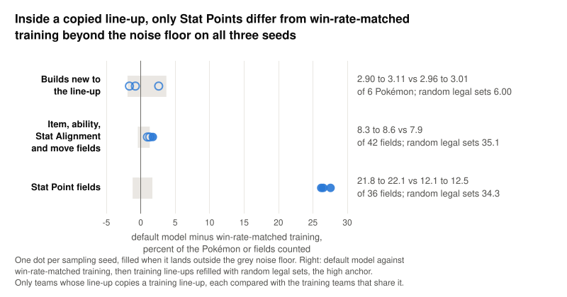
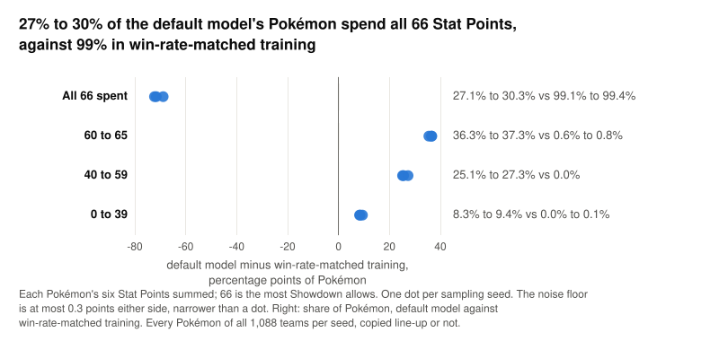
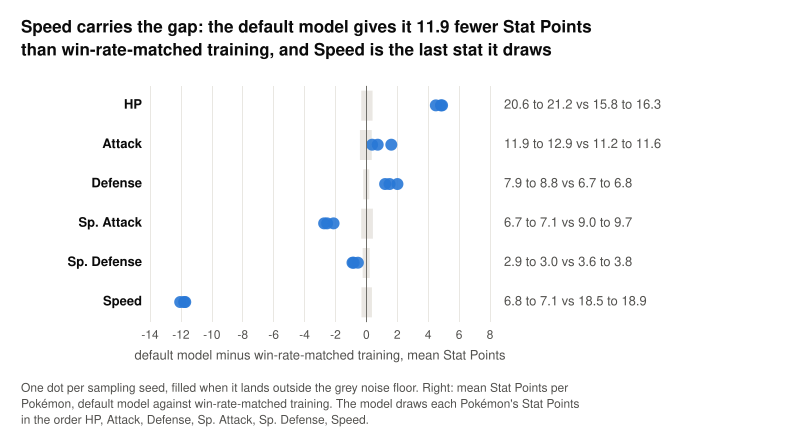

When the default model copies a training line-up, the six species of one real team it trained on, only its Stat Points, the 0 to 32 points a Pokémon puts in each stat with 66 at most in all, stand apart: 21.8 to 22.1 of 36 Stat Point fields differ from the closest training team with that line-up, against 12.1 to 12.5 for win-rate-matched training.

The model copies a training line-up in 58.7% to 59.4% of its teams, so this asks what else changes. The baseline, win-rate-matched training, is 1,088 training teams drawn with the same win-rate labels as the model's 17 asks, beside 1,088 model teams per sampling seed. A build is everything about a Pokémon except its species and Stat Points: item, ability, four moves and Stat Alignment. The noise floor is the range by which two draws of win-rate-matched training differ, and a gap counts when all three seeds land outside it on the same side.

<picture><source media="(prefers-color-scheme: dark)" srcset="https://raw.githubusercontent.com/Rami-Ismael/Battle-Factory-of-Porygon-Pi/{sha}/notes/reports/diversity-measurement-2026-11-11/figures/within-line-up-dark.svg"></picture>

Builds new to the line-up sit inside the floor, the other 42 fields pass it on one seed of three, a borderline gap, and Stat Points sit far outside.

<picture><source media="(prefers-color-scheme: dark)" srcset="https://raw.githubusercontent.com/Rami-Ismael/Battle-Factory-of-Porygon-Pi/{sha}/notes/reports/diversity-measurement-2026-11-11/figures/stat-point-totals-dark.svg"></picture>

Most of that gap is points left unspent: across all its teams the model's Pokémon carry 57.9 to 58.4 points on average against 66.0 in win-rate-matched training, and the teams stay legal because Showdown allows at most 66.

<picture><source media="(prefers-color-scheme: dark)" srcset="https://raw.githubusercontent.com/Rami-Ismael/Battle-Factory-of-Porygon-Pi/{sha}/notes/reports/diversity-measurement-2026-11-11/figures/stat-point-by-stat-dark.svg"></picture>

Speed gets 6.8 to 7.1 points against 18.5 to 18.9 in win-rate-matched training; the model draws it last, when on average it could still take 12.7 to 13.2.

For rare line-ups, those shared by 1 to 5 training teams, the model's builds do differ more than training's; the first table below gives the split.

One question stays open: has the network not learned that Speed takes whatever points remain, or does guidance 2 flatten that prediction? Sampling the same 17 asks at guidance 1 would separate the two: if the share spending all 66 climbs toward training's 99%, guidance flattens it; if it stays near 28%, the network never learned it.

Full numbers inside a copied line-up, and the rare line-up split

Ranges are the three sampling seeds or the three training draws. Every measure here counts only teams whose line-up copies a training line-up, each compared with the training teams that share it; a training team is left out of its own comparison.

| Teams | Line-up copied | Builds new to the line-up, of 6 | Recombined builds | Some build new | All six builds from one training team | Item, ability, Stat Alignment and move fields of 42 | Stat Point fields of 36 |
|---|---|---|---|---|---|---|---|
| Default model | 58.7% to 59.4% | 2.90 to 3.11 | 13.6% to 19.7% | 80.3% to 86.4% | 0% | 8.3 to 8.6 | 21.8 to 22.1 |
| Win-rate-matched training, the baseline | 70.6% to 71.9% | 2.96 to 3.01 | 13.8% to 16.1% | 83.9% to 86.2% | 0% | 7.9 | 12.1 to 12.5 |
| Any-win-rate training | 73.8% to 77.1% | 2.80 to 2.88 | 15.8% to 16.6% | 83.4% to 84.2% | 0% | 7.2 to 7.5 | 12.4 to 12.8 |
| One training team repeated | 100% | 0 | 0% | 0% | 100% | 0 | 0 |
| Training line-ups refilled with random legal sets | 100% | 6.00 | 0% | 100% | 0% | 35.1 | 34.3 |
| Noise floor | -3.0 to +1.5 percentage points | -0.12 to +0.22 | -4.1 to +2.8 percentage points | -2.8 to +4.1 percentage points | 0 | -0.18 to +0.55 | -0.42 to +0.61 |

The split by how many training teams share the line-up, default model against win-rate-matched training:

| Line-up shared by | Share of all teams | Builds new to the line-up, of 6 | Fields of 42 | Stat Point fields of 36 |
|---|---|---|---|---|
| 1 training team | 4.6% to 5.5% against 7.4% to 10.8% | 5.54 to 5.80 against 4.67 to 4.96, beyond the floor | 13.9 to 17.3 against 10.3 to 12.3, beyond the floor | 24.9 to 25.4 against 16.2 to 17.5, beyond the floor |
| 2 to 5 training teams | 7.5% to 8.5% against 11.4% to 12.7% | 4.72 to 5.05 against 4.15 to 4.38, beyond the floor | 11.5 to 12.3 against 8.4 to 9.4, beyond the floor | 24.2 to 24.4 against 15.0 to 15.2, beyond the floor |
| 6 or more training teams | 45.7% to 46.6% against 48.4% to 51.5% | 2.21 to 2.56 against 2.32 to 2.38, inside the floor | 6.9 to 7.4 against 7.0 to 7.2, inside the floor | 21.0 to 21.3 against 10.7 to 11.2, beyond the floor |

Full numbers: Stat Points spent

Every Pokémon of all 1,088 teams per seed or draw, 6,528 Pokémon per row, copied line-up or not. Speed room is what Speed could still take when it is drawn: 66 minus the other five stats, at most 32.

| Teams | All 66 spent | 60 to 65 | 40 to 59 | 0 to 39 | Mean total | HP | Attack | Defense | Sp. Attack | Sp. Defense | Speed | Speed room | Speed below its room |
|---|---|---|---|---|---|---|---|---|---|---|---|---|---|
| Default model | 27.1% to 30.3% | 36.3% to 37.3% | 25.1% to 27.3% | 8.3% to 9.4% | 57.9 to 58.4 | 20.6 to 21.2 | 11.9 to 12.9 | 7.9 to 8.8 | 6.7 to 7.1 | 2.9 to 3.0 | 6.8 to 7.1 | 12.7 to 13.2 | 62.9% to 65.4% |
| Win-rate-matched training, the baseline | 99.1% to 99.4% | 0.6% to 0.8% | 0.0% | 0.0% to 0.1% | 66.0 | 15.8 to 16.3 | 11.2 to 11.6 | 6.7 to 6.8 | 9.0 to 9.7 | 3.6 to 3.8 | 18.5 to 18.9 | 18.6 to 19.0 | 0.4% to 0.5% |
| Any-win-rate training | 99.2% to 99.3% | 0.7% to 0.8% | 0.0% | 0.0% | 66.0 | 15.9 to 16.2 | 11.2 to 11.4 | 6.7 to 6.9 | 9.4 to 9.6 | 3.4 to 3.7 | 18.7 to 19.1 | 18.7 to 19.1 | 0.5% |
| All 170,785 training teams | 99.3% | 0.7% | 0.0% | 0.0% | 66.0 | 16.0 | 11.6 | 6.8 | 9.2 | 3.5 | 18.9 | 18.9 | 0.5% |

Every model-minus-baseline difference in this table is beyond its noise floor on all three seeds; the floors are at most 0.3 percentage points for the shares and at most 0.42 points for the stat means.

Definitions of the three measures

- **Within-line-up new builds** counts, for a team with a copied line-up, how many of its six Pokémon, 0 to 6, have a build that no training team with the same six species gives that species. Few such training teams push it up.
- **Set distance by field type** counts the fields that differ from the training team with the same six species that differs least, Pokémon paired by species: items, abilities, moves and Stat Alignments together make 42 fields, Stat Points 36. Each part takes its own closest training team, and the two are never summed, since 36 Stat Point fields would swamp the other 42.
- **Recombined builds** is the share of teams with a copied line-up whose six builds each appear in some training team with that line-up, though no one training team holds all six.

All three are in `notes/GLOSSARY.md`.

Cause in the code, and caveats

- `code/src/stat_points.py` lines 41 to 48, `allowed_stat_points`, keep each stat at most 32 and each Pokémon's total at most 66 while sampling; nothing requires the total to reach 66.
- `code/src/diffusion84.py` line 39 sets the draw order with every Stat Point last, each Pokémon's in the order HP, Attack, Defense, Sp. Attack, Sp. Defense, Speed. In training, Speed nearly always takes its whole room; in the model's teams it falls short of that room for 62.9% to 65.4% of Pokémon.
- Which of the network or guidance 2 causes the shortfall is untested; the guidance 1 run above would answer it.
- Against any-win-rate training, the 42 other fields do differ beyond the floor on every seed, by 0.85 to 1.27 fields. That comparison reuses the floor from win-rate-matched pairs.
- Splitting the 42 fields by type, against the training team closest on those 42 fields, puts items 0.33 to 0.46 fields of 6 above win-rate-matched training and Stat Alignment 0.37 to 0.42 below, both beyond the floor. The Stat Point fields are read against the team closest on the 36 Stat Point fields, so Stat Points never choose the team the other field types are compared with.
- Code: `code/scripts/novelty_within_lineup.py`, `code/scripts/stat_points_spent.py` and their tests. Figures: `notes/reports/diversity-measurement-2026-11-11/build_figures_within_line_up.py`. Result files: `~/vgc-data/results/novelty_within_lineup_2026-11-11.json` and `~/vgc-data/results/stat_points_spent_2026-11-11.json`.
- No model team holds all six builds of one training team, and no win-rate-matched training team does either, since no two training teams share all 48 non-Stat-Point fields.

Commit `{short_sha}` on branch `t3/queue-experiments-from-issues`; files are listed under the caveats.

Corrected 2026-11-11: the item and Stat Alignment split is now read against the training team closest on the 42 non-Stat-Point fields instead of the one closest on all 78, which turns the item gap above win-rate-matched training, 0.25 to 0.36 fields, into 0.33 to 0.46, and the Stat Alignment gap below it, 0.51 to 0.56, into 0.37 to 0.42; both stay beyond the floor.
