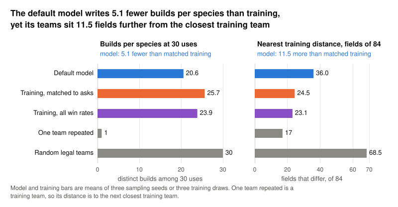
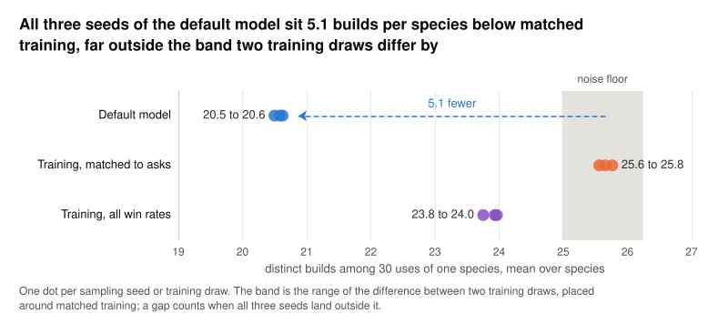
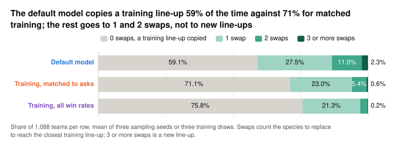
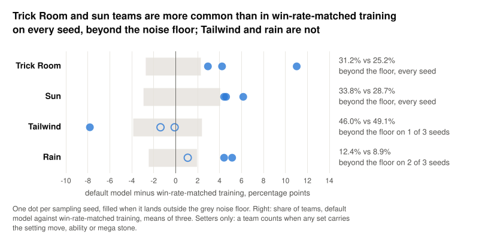

**Result of [Measure diversity of the default model's teams](https://github.com/Rami-Ismael/Battle-Factory-of-Porygon-Pi/issues/264), 2026-11-11.**

The project's default model is a masked discrete diffusion model that writes a Pokémon team of six as 84 fields, 14 per Pokémon: species, item, ability, four moves, Stat Alignment and six Stat Points values. It is conditioned on a target win rate, called the ask, and this measurement asks whether its teams are as varied as the real teams it was trained on. Each comparison puts 1,088 model teams beside 1,088 training teams whose win-rate labels match the asks.

The model writes about 5 fewer builds per species than those win-rate-matched training teams, 20.6 against 25.7, and its teams sit about 12 fields further from the closest training team, 36.0 against 24.5 fields of 84. Both gaps are far outside the noise floor, the band within which two draws of training teams differ from each other.

<picture><source media="(prefers-color-scheme: dark)" srcset="https://raw.githubusercontent.com/Rami-Ismael/Battle-Factory-of-Porygon-Pi/c27f21c52c8f25c228dcd0fc4fef5151d6039840/notes/reports/diversity-measurement-2026-11-11/figures/teaser-dark.svg"></picture>

The model writes fewer kinds of sets for each species, yet it combines them into teams further from any training team than training teams sit from each other. Each panel runs from one training team repeated, the least variety possible, to random legal teams, the most, and training sits between the two.

### How to read this

| Row | What it is |
|---|---|
| Default model | 1,088 teams from the model, 64 per ask on 17 asks, drawn once for each of sampling seeds 1, 2 and 3 |
| Win-rate-matched training | 1,088 real training teams, 64 per ask, each placed at the ask nearest its win-rate label; the baseline |
| Any-win-rate training | 1,088 real training teams drawn at random, whatever their win rate |
| One training team repeated | One training team copied 1,088 times, the low end of every scale |
| Random legal teams | 1,088 teams of random legal sets with randomly placed Stat Points, the high end |

| Measure | What it counts | More variety when |
|---|---|---|
| Builds per species | Distinct builds among 30 uses of one species, averaged over species | Higher, at most 30 |
| Novelty | Species swaps from a team's six species to the closest training team's six | More swaps |
| Nearest training distance | Fields of 84 that differ from the closest training team | Higher |
| Archetype share | Share of teams carrying the setter of each battle condition | No direction; compared with training |

The default model is epoch 80 of one training run on 170,785 real teams, each labelled with its win rate: the share of battles it wins against the top-50 meta teams, the 50 real teams every team in this project is scored against, with the same behaviour-cloning battle policy playing both sides. It samples with classifier-free guidance weight 2 on that win-rate condition. The 17 asks run from 1/24 to 17/24, about 0.04 to 0.71. Teams at different win rates can differ, so the baseline draws training teams with the same mix of win-rate labels as the asks, and any gap then comes from the model rather than from the mix. The any-win-rate training row shows how much that mix alone moves each measure. The noise floor comes from 20 pairs of separate win-rate-matched training draws: it is the 2.5% to 97.5% range of their 20 differences, placed around the baseline. A gap counts when all three model seeds land outside it on the same side.

### Builds per species

A set is everything about one Pokémon except its species: item, ability, four moves, Stat Alignment and Stat Points. Stat Points are the points a set gives its six stats, 0 to 32 per stat and 66 at most in total. A build is a set without its Stat Points. Two Garchomp that differ only in item, one holding Choice Scarf and one Life Orb, are two builds; two that differ only in Stat Points are one build. Builds per species takes 30 uses of one species, counts the distinct builds among them, repeats that draw 20 times and averages, then averages over every species used at least 30 times. Drawing the same 30 uses for every species keeps a common species from scoring higher only because it appears more often.

<picture><source media="(prefers-color-scheme: dark)" srcset="https://raw.githubusercontent.com/Rami-Ismael/Battle-Factory-of-Porygon-Pi/c27f21c52c8f25c228dcd0fc4fef5151d6039840/notes/reports/diversity-measurement-2026-11-11/figures/builds-dark.svg"></picture>

All three seeds sit 5.1 builds below win-rate-matched training, against a noise floor of -0.68 to +0.58 builds. Restricted to the species both sides use 30 times, the gap is 4.84 to 5.00 builds. Any-win-rate training shows fewer builds per species than the win-rate-matched baseline, a mean of 23.9 against 25.7, so part of the baseline's variety comes from matching the label mix.

### Novelty

A line-up is a team's six species, in any order. Take a training team of Charizard, Garchomp, Dragonite, Gengar, Gyarados and Tyranitar. A model team with those same six species is 0 swaps away, a copied line-up; one with Kingambit in place of Tyranitar is 1 swap away. Novelty counts the swaps from a team's line-up to the closest training line-up, in four bins: 0, 1, 2, and 3 or more, the last counting as a new line-up.

<picture><source media="(prefers-color-scheme: dark)" srcset="https://raw.githubusercontent.com/Rami-Ismael/Battle-Factory-of-Porygon-Pi/c27f21c52c8f25c228dcd0fc4fef5151d6039840/notes/reports/diversity-measurement-2026-11-11/figures/novelty-dark.svg"></picture>

The model copies a training line-up less often, 59% against 71% for win-rate-matched training, and the difference goes to one and two swaps. Line-ups three or more swaps away stay under 4% on every seed and do not clear the noise floor against win-rate-matched training.

### Nearest training distance

Nearest training distance compares a team's 84 fields with every training team, pairs the six Pokémon in whichever order gives the fewest differences, and keeps the smallest count. A team that copies a training team's species and builds but changes the Stat Points of two Pokémon is at most 12 fields away; 0 means an exact copy. It is the right panel of the first figure. No model team is a copy at 0 fields. The median model team is 34 fields from its closest training team, against 24 fields from a win-rate-matched training team to its closest other training team. One training team repeated sits at 17, not 0, because each training team is left out of the reference it is compared with, so its distance is to the next closest training team.

### Archetypes

An archetype is a battle condition a team sets up: sun, rain, sand or snow; electric, grassy, misty or psychic terrain; Trick Room; or Tailwind. A team is in one when any of its sets carries the setter, the move, ability or mega stone that sets it up. A mega stone counts when the holder's mega form has the setting ability. A team can be in several archetypes or none. Whether the team sets the condition up in battle is not measured.

<picture><source media="(prefers-color-scheme: dark)" srcset="https://raw.githubusercontent.com/Rami-Ismael/Battle-Factory-of-Porygon-Pi/c27f21c52c8f25c228dcd0fc4fef5151d6039840/notes/reports/diversity-measurement-2026-11-11/figures/archetypes-dark.svg"></picture>

Trick Room and sun are above win-rate-matched training beyond the noise floor on every seed. Tailwind and rain are not. Grassy, misty and psychic terrain are near 0% in every row; their setting abilities are not in the Regulation M-B vocabulary, the values the model can write under the rule set this project plays.

Full numbers: builds, Novelty and nearest training distance

Ranges are the three sampling seeds or the three training draws. Validation teams are real labelled teams from the 2% held out of training, drawn 64 per ask like the baseline; they match training on every measure, so they appear only here.

| Teams | Builds per species at 30 uses | Line-up copied, 0 swaps | 1 swap | 2 swaps | 3 or more swaps | Nearest training distance, mean fields of 84 |
|---|---|---|---|---|---|---|
| Default model | 20.50 to 20.62 | 58.7% to 59.4% | 26.4% to 28.8% | 9.5% to 11.9% | 0.9% to 3.7% | 35.9 to 36.0 |
| Win-rate-matched training, the baseline | 25.56 to 25.76 | 70.6% to 71.9% | 22.3% to 23.3% | 5.2% to 5.5% | 0.6% | 24.3 to 24.7 |
| Any-win-rate training | 23.75 to 23.97 | 73.8% to 77.1% | 19.9% to 23.3% | 2.6% to 2.9% | 0% to 0.3% | 22.9 to 23.4 |
| Validation teams | 25.74 | 72.4% | 22.2% | 4.7% | 0.7% | 24.6 |
| Random legal teams | 30.00 | 0% | 0.1% | 3.5% | 96.4% | 68.5 |
| Noise floor, difference of two win-rate-matched training draws | -0.68 to +0.58 | -3.0 to +1.5 percentage points | -2.4 to +2.6 percentage points | -1.2 to +1.1 percentage points | -0.5 to +0.5 percentage points | -0.23 to +0.63 |

The figures show means of the three seeds or draws. One training team repeated has 1 build per species and a nearest training distance of 17 fields, its distance to the next closest training team.

Full numbers: archetype shares

Setters only, with mega stones counted as setters.

| Teams | Tailwind | Trick Room | Sun | Rain |
|---|---|---|---|---|
| Default model | 42.1% to 48.2% | 27.8% to 37.0% | 32.0% to 35.2% | 10.8% to 14.2% |
| Win-rate-matched training, the baseline | 48.3% to 49.9% | 24.6% to 26.0% | 27.4% to 29.7% | 7.9% to 9.7% |
| Noise floor | -3.9 to +2.4 percentage points | -2.7 to +2.3 percentage points | -2.9 to +4.1 percentage points | -2.5 to +1.9 percentage points |

Method notes and caveats

- Before any measure was added, the unchanged script reproduced the 2026-11-09 starting result on this map exactly, 351 of 351 values.
- A set stores the base ability, not the mega form's. A Charizard holding Charizardite Y, whose mega form sets sun, was therefore missed as a sun setter in 196 of 197 cases in model seed 1 until the five setter mega stones were added to the setter list.
- In a row drawn from the training teams, each team is left out of the reference it is compared with, so it never finds itself at distance 0.
- The model gives the ability Snow Warning to 30 of 67 Pokémon holding Froslassite, the Froslass mega stone, against 3 of 53 in training. Whether that pairing is legal is unchecked.
- The comparison against any-win-rate training reuses the noise floor from the win-rate-matched pairs.
- Setters only: whether an archetype is used in battle is not measured.
- Figures are ECharts 6.1.0 rendered to SVG by `build_figures.py` and `render_svg.mjs`; `storyboard.md` gives each figure's sentence. In code and in the result file, the rows keep their keys: `model_s`, `train_s` for win-rate-matched training, `train_all_s` for any-win-rate training, `copied`, `random` and `val`.

Code, tests and the page are on branch `t3/queue-experiments-from-issues`, commit `102fc80d`: `code/scripts/diversity_vs_training.py`, `code/scripts/nearest_training_distance.py`, page `notes/reports/diversity-measurement-2026-11-11/index.html`. Figures are in commit `c27f21c5`. Result file: `~/vgc-data/results/diversity_vs_training_2026-11-11.json`.
