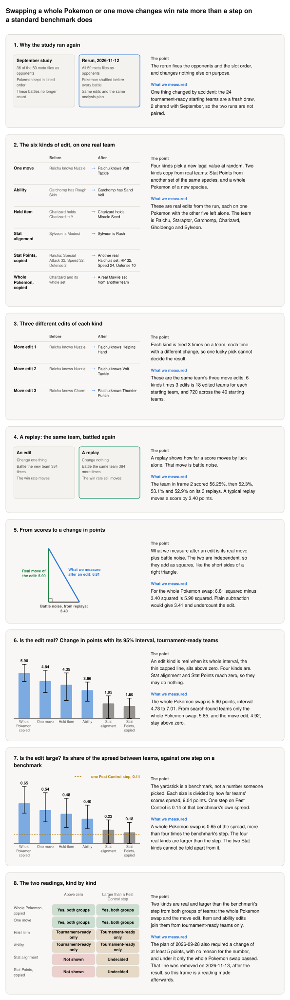

**Storyboard for [Rerun the one-edit study per edit kind with shuffled slots against the full meta](https://github.com/Rami-Ismael/Battle-Factory-of-Porygon-Pi/issues/313), 2026-11-13.**

A team is six Pokemon, listed in six slots. The meta is the 50 highest-placing team files, one team listed twice. We change one thing on a team, battle the old and the new team against the meta, and see how far the win rate moves. September's battles used rules the project no longer counts, so the study ran again.

<picture><source media="(prefers-color-scheme: dark)" srcset="https://raw.githubusercontent.com/Rami-Ismael/Battle-Factory-of-Porygon-Pi/COMMIT/notes/reports/edit-kind-rerun-2026-11-13/issue-313/figures/storyboard-dark.svg"></picture>

### How to read this

| Term | What it means here |
|---|---|
| Edit kind | What one rule-abiding edit changes on one Pokemon: one of its four moves, its ability, the item it holds, its stat alignment, its Stat Points, or the whole Pokemon |
| Stat alignment, Stat Points | Two settings of a Pokemon's numbers: which stat is raised and which lowered, and how its training points are divided among its stats |
| Shuffled slots | The six Pokemon get a new random order before every battle. The battle policy picks by position, so a fixed order biases scores |
| Change, in points | The typical size of the win-rate move from one edit, in percentage points, in either direction, with the size of replay noise subtracted |
| Battle noise | How far a win rate moves when the same team is simply battled again. Measured by 3 replays of each starting team |
| Beyond battle noise | Test 1. A larger share of edits than of replays moves the win rate past what chance allows, and the change is at least 5 points |
| Rougher than Pest Control | Test 2. Pest Control is a standard optimisation benchmark where one step barely changes the score. Passing means a team's score predicts its edited neighbour's score less well than there, by correlation |
| Meta teams, search-found teams | The two groups of starting teams: 24 real teams from outside the top 50, and 16 teams an earlier search produced |

The frames and their sentences are in `notes/reports/edit-kind-rerun-2026-11-13/issue-313/`. The plan is `code/docs/ruggedness2.md`.
