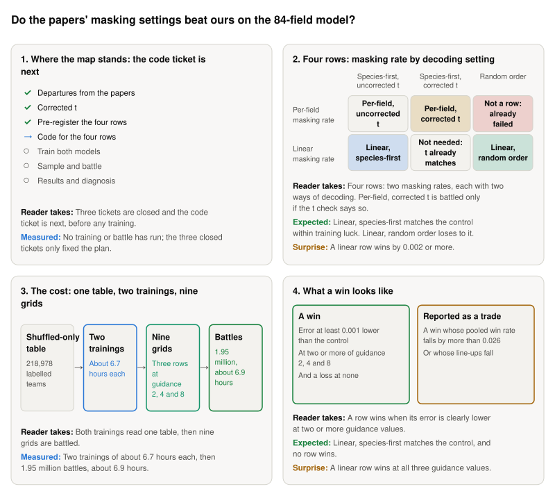

**Storyboard for [Masking-rate map: per-field versus linear masking rate on the 84-field model, and where our code departs from MD4 and LLaDA](https://github.com/Rami-Ismael/Battle-Factory-of-Porygon-Pi/issues/291), 2026-11-11.**

Our model writes a team of six Pokémon as 84 fields, such as a species or a move. Two published papers, MD4 and LLaDA, train and sample such models differently from us. This map asks whether their settings do better. A row is one way to train and sample the model, and four are compared.

<picture><source media="(prefers-color-scheme: dark)" srcset="https://raw.githubusercontent.com/Rami-Ismael/Battle-Factory-of-Porygon-Pi/COMMIT/notes/reports/masking-rate-map-2026-11-11/issue-291/figures/storyboard-dark.svg"></picture>

### How to read this

| Term | What it means here |
|---|---|
| Masking rate | The chance a field is hidden in training. Per-field, ours: species are almost never hidden. Linear, the papers': every field has the same chance |
| Row | One way to train and sample the model. Four are compared. The control is Per-field, uncorrected t: our own settings |
| Corrected t | The t at which training hid as many fields as are still hidden at this pass |
| t check | Measures how far the model's choices move when told the corrected t: 0 is no change. Under 0.01, the correction cannot matter, and the row is not battled |
| Grid | One battled run of a row at one guidance value: teams sampled at 23 asks, each team battled 49 times |
| Ask-versus-got error | How far the win rate the teams get is from the win rate asked for. Lower is better. A row must be 0.001 lower to count |
| Guidance | How hard the sampler pushes toward the win rate asked for. 1 is no push, and higher pushes harder |

The frames and their sentences are in `notes/reports/masking-rate-map-2026-11-11/issue-291/`. The plan is `code/docs/masking-rate-rows.md`.
