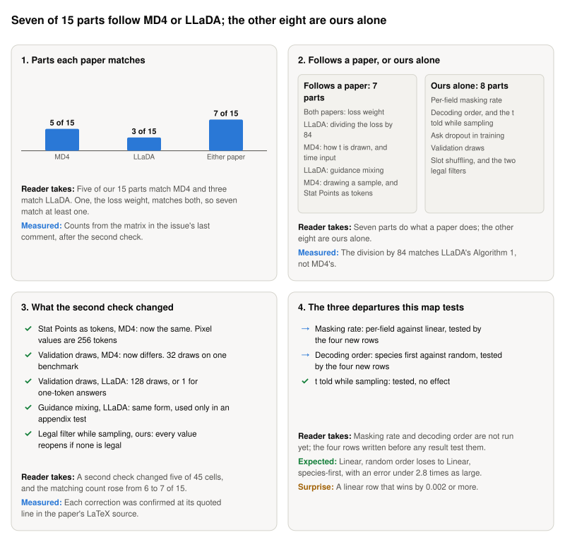

**Storyboard for [Departures: where does our 84-field discrete diffusion code depart from MD4 and LLaDA?](https://github.com/Rami-Ismael/Battle-Factory-of-Porygon-Pi/issues/292), 2026-11-11.**

Our model writes a team of six Pokémon as 84 fields. We split its code into 15 parts, such as how fields are hidden in training and in what order they are filled. Each part was compared with two published papers, MD4 and LLaDA. A second check then verified all 45 cells: 15 parts for ours and for each paper.

<picture><source media="(prefers-color-scheme: dark)" srcset="https://raw.githubusercontent.com/Rami-Ismael/Battle-Factory-of-Porygon-Pi/f764a81592b8637b9bfe6c359d003c8dcba8ab9e/notes/reports/masking-rate-map-2026-11-11/issue-292/figures/storyboard-dark.svg"></picture>

### How to read this

| Term | What it means here |
|---|---|
| Part | One design choice in our code, such as the masking rate or the decoding order. There are 15 |
| Follows a paper | Our code does the same thing as that paper in this part |
| Ours alone | No paper does it our way: the paper differs, or has no such part |
| t | A number from 0 to 1 that the model is told: how much of the team is still hidden |
| Decoding order | The order the sampler fills fields in. Ours: all six species first. The papers: random, or most confident first |
| The four new rows | The four ways of training and sampling that this map will battle, to test the masking rate and the decoding order |

The frames and their sentences are in `notes/reports/masking-rate-map-2026-11-11/issue-292/`. The plan is `code/docs/masking-rate-rows.md`.
