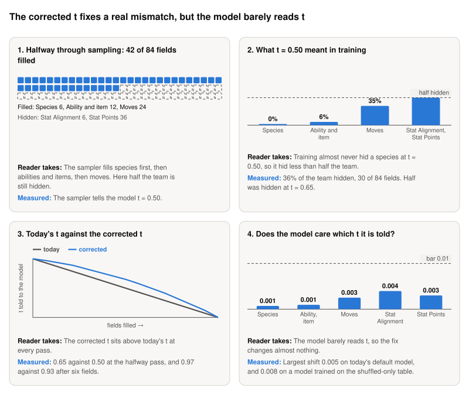

**Storyboard for [Corrected t: how should a per-field-masking-rate model be given t while decoding in a fixed order, to match MD4?](https://github.com/Rami-Ismael/Battle-Factory-of-Porygon-Pi/issues/293), 2026-11-11.**

The model fills a team's 84 fields in 84 passes. At each pass it is told t, a number from 0 to 1 that says how much of the team is still hidden. Training and the sampler disagree about what a given t means. This ticket worked out the t that matches training, as the published MD4 paper does, and a later check measured whether the model cares.

<picture><source media="(prefers-color-scheme: dark)" srcset="https://raw.githubusercontent.com/Rami-Ismael/Battle-Factory-of-Porygon-Pi/f764a81592b8637b9bfe6c359d003c8dcba8ab9e/notes/reports/masking-rate-map-2026-11-11/issue-293/figures/storyboard-dark.svg"></picture>

### How to read this

| Term | What it means here |
|---|---|
| t | A number from 0 to 1 that the model is told: how much of the team is still hidden |
| Pass | One run of the model while it fills a team. There are 84 passes, one field each |
| Field | One of the 84 values that make a team: for each of six Pokémon its species, ability, item, four moves, Stat Alignment and six Stat Points |
| Per-field masking rate | In training a field is hidden with chance t raised to a power: 16 for species, 4 for ability and item, 1.5 for moves, 1 otherwise |
| Corrected t | The t at which training hid as many fields as are still hidden at this pass |
| Shift in choices | How far the model's choices move when told another t: 0 is no change, 1 a complete change. The bar of 0.01 was set before measuring |

The frames and their sentences are in `notes/reports/masking-rate-map-2026-11-11/issue-293/`. The plan is `code/docs/masking-rate-rows.md`.
