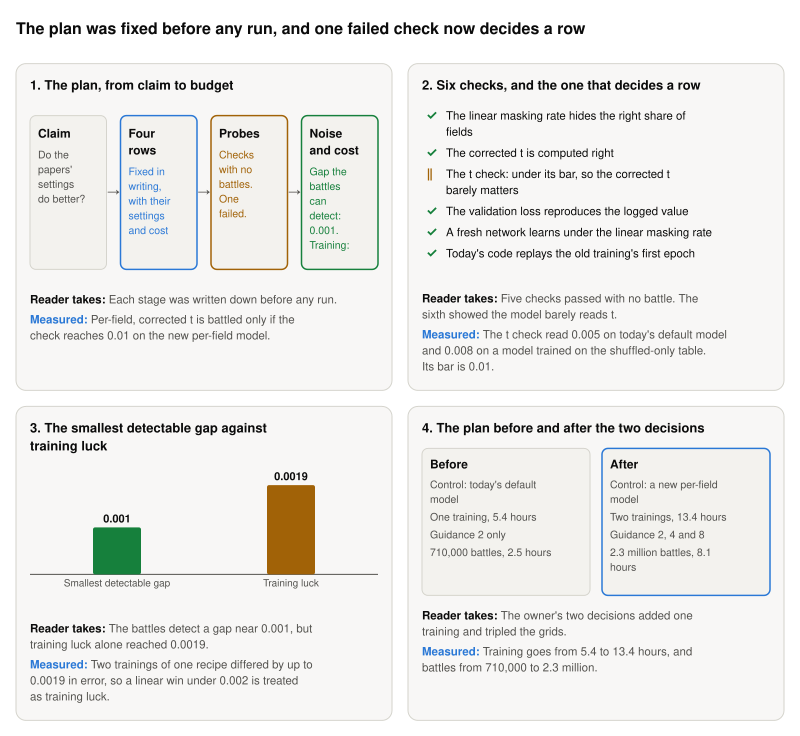

**Storyboard for [Pre-register the four masking-rate rows](https://github.com/Rami-Ismael/Battle-Factory-of-Porygon-Pi/issues/294), 2026-11-11.**

A pre-registration writes the plan down before any training or battle, so a result cannot bend it afterwards. This one fixed four rows, each a way to train and sample the model, and ran six quick checks that need no battle. One of those checks now decides whether one row is battled at all.

<picture><source media="(prefers-color-scheme: dark)" srcset="https://raw.githubusercontent.com/Rami-Ismael/Battle-Factory-of-Porygon-Pi/COMMIT/notes/reports/masking-rate-map-2026-11-11/issue-294/figures/storyboard-dark.svg"></picture>

### How to read this

| Term | What it means here |
|---|---|
| Row | One way to train and sample the model. Four are compared. The control is Per-field, uncorrected t: our own settings |
| Masking rate | The chance a field is hidden in training. Per-field, ours: species are almost never hidden. Linear, the papers': every field has the same chance |
| Corrected t | The t at which training hid as many fields as are still hidden at this pass |
| t check | Measures how far the model's choices move when told the corrected t: 0 is no change. Under 0.01, the correction cannot matter, and the row is not battled |
| Smallest detectable gap | The smallest difference in error the planned battles can tell from noise: 0.001 |
| Training luck | The gap two trainings of one recipe show by chance alone: up to 0.0019 in error. A win under 0.002 is treated as luck |
| Shuffled-only table | The training teams whose win-rate labels come only from battles that shuffle a team's six Pokémon |

The frames and their sentences are in `notes/reports/masking-rate-map-2026-11-11/issue-294/`. The plan is `code/docs/masking-rate-rows.md`.
