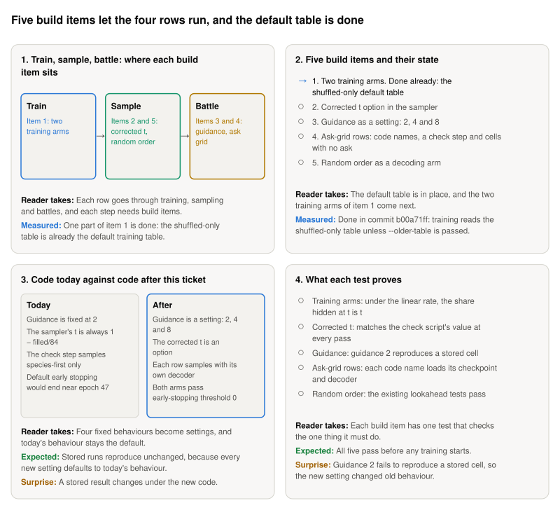

**Storyboard for [Add the linear masking rate and the corrected t to the 84-field code, with tests](https://github.com/Rami-Ismael/Battle-Factory-of-Porygon-Pi/issues/295), 2026-11-11.**

The model fills a team's 84 fields one pass at a time. This ticket adds five pieces of code, called build items, so that each of the four rows can be trained, sampled and battled. A row is one way to train and sample the model.

<picture><source media="(prefers-color-scheme: dark)" srcset="https://raw.githubusercontent.com/Rami-Ismael/Battle-Factory-of-Porygon-Pi/COMMIT/notes/reports/masking-rate-map-2026-11-11/issue-295/figures/storyboard-dark.svg"></picture>

### How to read this

| Term | What it means here |
|---|---|
| Row | One way to train and sample the model. Four are compared. The control is Per-field, uncorrected t: our own settings |
| Build item | One piece of code this ticket adds. There are five, numbered in frame 2 |
| Training arm | A named training run in the code. This ticket adds one for each masking rate |
| Shuffled-only table | The training teams whose win-rate labels come only from battles that shuffle a team's six Pokémon |
| Guidance | How hard the sampler pushes toward the win rate asked for. 1 is no push, and higher pushes harder |
| Corrected t | The t at which training hid as many fields as are still hidden at this pass |
| Stored cell | Teams an earlier run already sampled and battled, kept on disk. New code must reproduce them |

The frames and their sentences are in `notes/reports/masking-rate-map-2026-11-11/issue-295/`. The plan is `code/docs/masking-rate-rows.md`.
