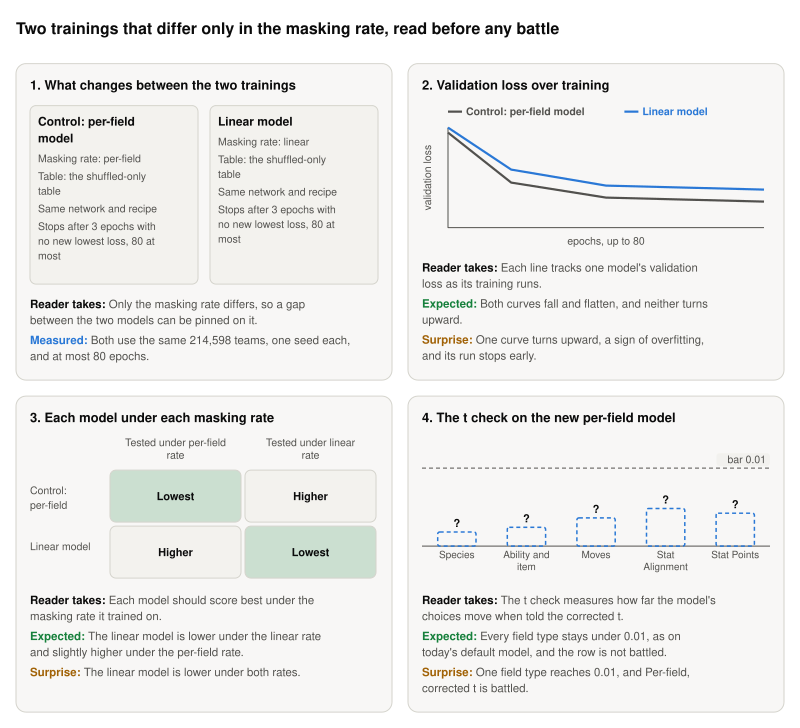

**Storyboard for [Train the 84-field model with the linear masking rate](https://github.com/Rami-Ismael/Battle-Factory-of-Porygon-Pi/issues/296), 2026-11-11.**

The model fills a team of six Pokémon, 84 fields in all, where each field is one value such as a species or a move. In training some fields are hidden, and the masking rate is the chance that a field is hidden. This ticket trains two models on the shuffled-only table and reads their validation loss before any battle.

<picture><source media="(prefers-color-scheme: dark)" srcset="https://raw.githubusercontent.com/Rami-Ismael/Battle-Factory-of-Porygon-Pi/COMMIT/notes/reports/masking-rate-map-2026-11-11/issue-296/figures/storyboard-dark.svg"></picture>

### How to read this

| Term | What it means here |
|---|---|
| Masking rate | The chance a field is hidden in training. Per-field, ours: species are almost never hidden. Linear, the papers': every field has the same chance |
| Validation loss | The loss on teams held out of training. Lower is better. It is only comparable under one masking rate |
| Shuffled-only table | The training teams whose win-rate labels come only from battles that shuffle a team's six Pokémon |
| Corrected t | The t at which training hid as many fields as are still hidden at this pass |
| t check | Measures how far the model's choices move when told the corrected t: 0 is no change. Under 0.01, the correction cannot matter, and the row is not battled |
| Per-field, corrected t | The row that samples the per-field model while telling it the corrected t |

The frames and their sentences are in `notes/reports/masking-rate-map-2026-11-11/issue-296/`. The plan is `code/docs/masking-rate-rows.md`.
