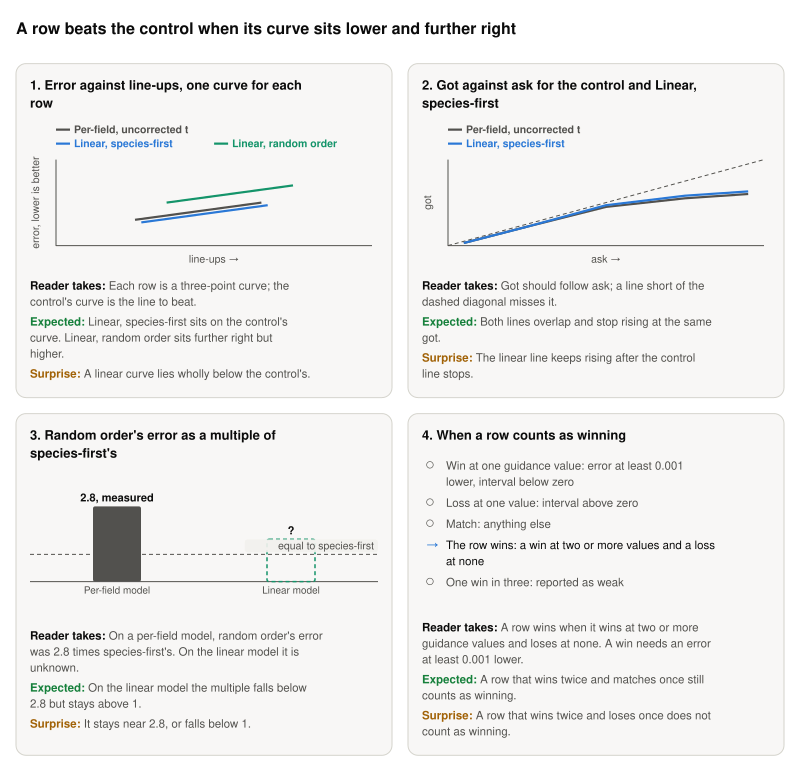

**Storyboard for [Sample and battle the four rows and post the results table](https://github.com/Rami-Ismael/Battle-Factory-of-Porygon-Pi/issues/297), 2026-11-11.**

Each row is a way to train and sample the model. Its teams are battled at guidance 2, 4 and 8, so a row becomes a curve of three points. This ticket runs those battles and judges each row against the control, Per-field, uncorrected t.

<picture><source media="(prefers-color-scheme: dark)" srcset="https://raw.githubusercontent.com/Rami-Ismael/Battle-Factory-of-Porygon-Pi/COMMIT/notes/reports/masking-rate-map-2026-11-11/issue-297/figures/storyboard-dark.svg"></picture>

### How to read this

| Term | What it means here |
|---|---|
| Row | One way to train and sample the model. Four are compared. The control is Per-field, uncorrected t: our own settings |
| Species-first and random order | The order fields are filled in: all six species first, or any order |
| Ask and got | The ask is the win rate the model is told to aim for. Got is the win rate its teams then score |
| Line-up | A team's six species. More distinct line-ups means more variety |
| Guidance | How hard the sampler pushes toward the win rate asked for. 1 is no push, and higher pushes harder |
| Ask-versus-got error | How far the win rate the teams get is from the win rate asked for. Lower is better. A row must be 0.001 lower to count |

The frames and their sentences are in `notes/reports/masking-rate-map-2026-11-11/issue-297/`. The plan is `code/docs/masking-rate-rows.md`.
