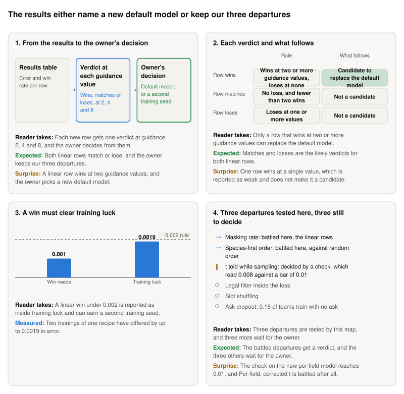

**Storyboard for [Results and diagnosis: what do the four rows and the departures list mean for our code?](https://github.com/Rami-Ismael/Battle-Factory-of-Porygon-Pi/issues/298), 2026-11-11.**

This is the last ticket: a conversation with the owner once the battles are done. Three rows are battled for sure, and a fourth only if its check says so. A linear row that wins becomes the candidate to replace the default model. If no row wins, our three tested departures from the papers stay as ours.

<picture><source media="(prefers-color-scheme: dark)" srcset="https://raw.githubusercontent.com/Rami-Ismael/Battle-Factory-of-Porygon-Pi/COMMIT/notes/reports/masking-rate-map-2026-11-11/issue-298/figures/storyboard-dark.svg"></picture>

### How to read this

| Term | What it means here |
|---|---|
| Departure | A place where our code differs from the papers MD4 and LLaDA. Three are tested here: the masking rate, the decoding order and the t told while sampling |
| Row | One way to train and sample the model. Four are compared. The control is Per-field, uncorrected t: our own settings |
| Default model | The model every run uses unless it names another. Today it is a per-field model trained on an older table |
| Guidance | How hard the sampler pushes toward the win rate asked for. 1 is no push, and higher pushes harder |
| Training luck | The gap two trainings of one recipe show by chance alone: up to 0.0019 in error. A win under 0.002 is treated as luck |
| Weak | One win among the three guidance values. It does not make a row a candidate |

The frames and their sentences are in `notes/reports/masking-rate-map-2026-11-11/issue-298/`. The plan is `code/docs/masking-rate-rows.md`.
