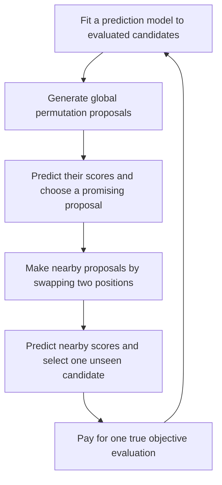

# Relevance of the 2025 surrogate-assisted memetic paper

Assessed on 20 October 2026 for the Pokémon counter-team search project.

**Verdict: medium relevance for selective reading about local proposals screened by a prediction model. Direct implementation reuse is low.** This is a useful newer example for deciding which nearby candidates deserve an expensive evaluation. It does not establish a better Pokémon search method or replace the current experiment queue.

Paper: Takashi Ikeguchi, Kei Nishihara, Yo Kawauchi, Yuji Koguma, and Masaya Nakata, [A surrogate-assisted memetic algorithm for permutation-based combinatorial optimization problems](https://www.sciencedirect.com/science/article/pii/S2210650225002184). *Swarm and Evolutionary Computation* 98, 102060, October 2025. [Publisher identifier](https://doi.org/10.1016/j.swevo.2025.102060).

## What I verified

The publisher abstract was available through search. The publisher page and its article download returned access errors in the research tool. An author manuscript was not located in the bounded search. I therefore did not verify article section numbers, experimental tables, or the full comparison protocol.

I found and read the authors' [public implementation](https://github.com/YNU-NakataLab/GBDTMA). Its description explicitly associates the repository with this paper. The code checked was revision `6d20bae1aec513eeb66b81910a9f1a34837979ee`. I read the main search loop, permutation generator, crossover operator, swap operator, population update, and quadratic-assignment objective. No code was executed.

The abstract reports 42 permutation instances under a limit of 1,000 objective evaluations and comparisons with other surrogate models. Those are author-reported results. I did not independently inspect their tables or verify the experimental configurations.

## The useful mechanism

The checked implementation follows this sequence:

The important distinction is that the local proposals are screened with the prediction model. The method does not pay for a true objective evaluation for every local proposal.

At the checked defaults, the main loop fits an ensemble of 100 boosted decision trees to all evaluated archive entries. It generates global candidates with partially mapped crossover, removes duplicate offspring, predicts their objective values, and sorts them. Around the most promising global candidate, it considers that candidate and 10 randomly generated two-position swaps. It removes candidates already in the evaluated archive, predicts the remaining scores, and evaluates the predicted best unseen candidate. It then adds that observation to the archive and rebuilds the population. [Main algorithm, lines 27–90](https://github.com/YNU-NakataLab/GBDTMA/blob/6d20bae1aec513eeb66b81910a9f1a34837979ee/GBDTMA/GBDTMA.m#L27-L90).

This code shows one bounded local proposal stage per iteration. It does not repeatedly walk through improving neighbours until reaching a certified local optimum. If all candidates in that local set have already been evaluated, it tries the next global candidate. The population update retains a best-scoring fraction and samples other archive entries. That rule is a population construction choice, not a guarantee of useful diversity. [Population update](https://github.com/YNU-NakataLab/GBDTMA/blob/6d20bae1aec513eeb66b81910a9f1a34837979ee/GBDTMA/PopUpdate_ElandDiv.m).

## Fit to your search problem

| Question | Assessment |
| --- | --- |
| Does it address expensive evaluations? | Yes. Surrogate screening selects candidates before true evaluation. This matches the purpose of your ridge acquisition stage. |
| Does it combine global and local proposals? | Yes. A promising global proposal supplies the centre for a small local proposal set. |
| Does it learn a neural team generator? | No. The checked implementation uses permutation crossover and a tree ensemble. It does not implement neural cross-entropy refitting. |
| Does its representation match a Pokémon team? | Only partly. Both are discrete. A permutation rearranges a fixed set of elements. A team chooses species and dependent legal settings, with interactions between them. |
| Do its local edits transfer directly? | No. A two-position permutation swap does not specify a legal move, item, or whole-Pokémon-set replacement. |
| Does it handle battle-score noise? | Not established. The checked quadratic-assignment objective is a deterministic matrix calculation. The loop has no repeated-evaluation allocation or score-uncertainty rule. |
| Does it justify replacing the ridge with boosted trees? | No. The model is worth a controlled comparison, but its permutation results do not establish better local rankings for teams. |

The [swap operator](https://github.com/YNU-NakataLab/GBDTMA/blob/6d20bae1aec513eeb66b81910a9f1a34837979ee/GBDTMA/OperatorSWAP.m) exchanges two entries. The [quadratic-assignment objective](https://github.com/YNU-NakataLab/GBDTMA/blob/6d20bae1aec513eeb66b81910a9f1a34837979ee/QAP/QAP.m#L39-L52) computes a fixed cost from flow and permuted location matrices. Randomness in proposal generation is different from observation noise in battle results.

Its evaluation accounting also differs from your current named configuration. The code evaluates the initial population and then one selected candidate per iteration. The clean neural cross-entropy reference proposes 512 candidates and acquires up to 128 before the next generation. Transferring the paper's serial schedule would change batching, model-training frequency, and elapsed cost. A limit of 1,000 deterministic objective calls is not a limit of 1,000 battles or a ready-made Pokémon budget.

## What you can reuse

The most useful idea is **generate several nearby legal alternatives cheaply, rank them with the existing predictor, then spend battle evaluations on selected candidates**. This could fit a local proposal branch within the existing combined proposal and acquisition stages.

For the first comparison, keep the ridge model and the chosen baseline's other rules fixed. Define one legal edit type and an anchor rule, then compare that proposal change under the applicable battle and elapsed-time controls. Record actual changed fields, duplicate attempts, acquisition survival, and independently evaluated finalist win rate. This is a proposed transfer, not a result from the paper.

A separate later comparison could test boosted decision trees against ridge regression using the same available labels and comparable features. Check the ranking of nearby alternatives, not just average global prediction error. The paper does not supply a validated encoding for Pokémon species, legal move choices, or contextual team interactions.

Repeated noisy labels, selection of lucky candidates, and uncertainty in small win-rate differences remain project-specific problems. The inspected code does not resolve them. Nor does its archive rejection rule automatically apply to a battle cache, where another evaluation of the same team can provide useful independent evidence.

## Reading priority relative to the 2013 paper

Read this newer algorithm first if your immediate question is how a surrogate can screen local proposals before expensive evaluation. It is closer to that decision than a deterministic scheduling case study without your acquisition structure.

Retain the 2013 cross-entropy memetic paper as optional background for combining a learned sampling distribution with local improvement. The 2025 paper does not replace that particular cross-entropy connection. Neither paper should move ahead of the project's more directly matched battle-based search readings solely because of publication year.

The recommended selective read is currently the [main implementation, lines 37–90](https://github.com/YNU-NakataLab/GBDTMA/blob/6d20bae1aec513eeb66b81910a9f1a34837979ee/GBDTMA/GBDTMA.m#L37-L90), followed by the swap and population-update functions. Article section and page recommendations remain unverified until the full text is available.

This assessment follows the local reading-list policy: current-stage search-loop relevance comes before the grade, and MED can justify a focused read for one design decision. It does not change the reading list, website, current search code, or experiment allocation.
